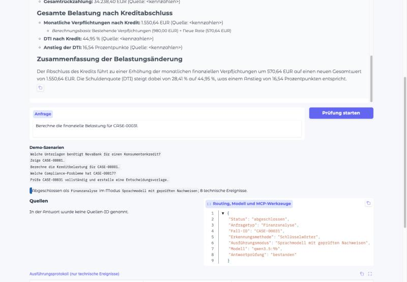
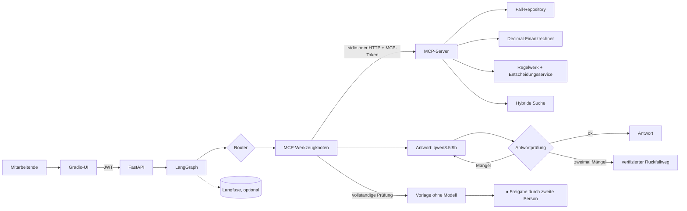
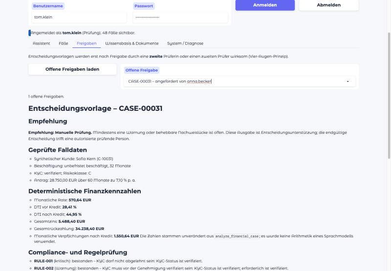
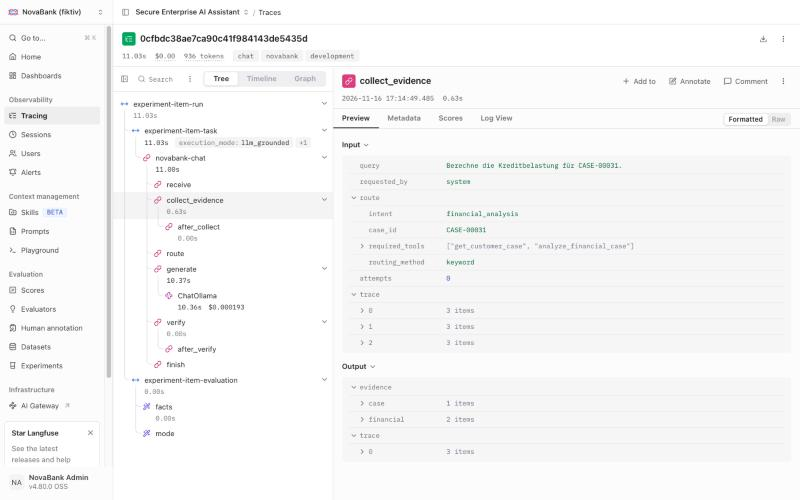

# Secure Enterprise AI Assistant

Lokale, KI-gestützte Entscheidungsunterstützung für Kreditfälle der **NovaBank Financial
Services AG**, einer vollständig erfundenen Bank. Das Projekt zeigt, wie man ein LLM-System so
baut, dass Fakten nachprüfbar bleiben: deterministische Fachlogik, Advanced RAG, das Model
Context Protocol (MCP), ein LangGraph-Workflow mit Freigabe durch einen Menschen, Messung der
Antwortqualität, Tracing und Sicherheitskontrollen – alles lokal auf einem MacBook mit einem
9B-Modell.

> **Hinweis zu den Daten:** NovaBank gibt es nicht. Alle Kunden, Fälle, Richtlinien, Regeln,
> Beträge und Dokumente in diesem Repository sind synthetisch und nur für Demonstration, Tests
> und Portfolio erstellt. Die Software ist keine Finanz- oder Rechtsberatung.



## Worum es geht

Ein Assistent für Kreditsachbearbeitung muss mehr können als gut klingende Texte. Er braucht
geprüfte Daten, exakte Rechnungen, belegte Richtlinienaussagen, kontrollierten Werkzeugeinsatz,
messbare Qualität und einen Ablauf, den man nachvollziehen kann. Deshalb sind die Aufgaben hier
streng getrennt:

- **Fakten kommen aus Code:** Fallakten, Raten, Schuldendienstquote (DTI), Regelprüfung und
  Empfehlung liefern deterministische Services hinter MCP.
- **Sprache kommt aus dem Modell:** `qwen3.5:9b` formuliert nur aus diesen Nachweisen.
- **Jede Antwort wird geprüft:** Zahlen und Dokument-IDs müssen in den Nachweisen stehen.
- **Entscheidungen trifft ein Mensch:** Eine Entscheidungsvorlage wird erst gültig, wenn eine
  *zweite* prüfende Person sie freigibt.

## Was gebaut ist (v2.0)

- 48 reproduzierbare synthetische Kreditfälle in acht Risikoszenarien
- Decimal-genaue Annuität, Zinsen, Rückzahlung, DTI vor und nach Kredit
- zehn versionierte Regeln (JSON) mit Quellenangabe; Empfehlung aus dem Regelwerk
- 18 synthetische Richtlinien, Klassifizierung `intern` / `vertraulich`
- hybride Suche: Embeddings (`qwen3-embedding:0.6b` über Ollama) + BM25 + Dokument-/Abschnitts-
  kennungen, persistenter FAISS-Index, Filter vor dem Ranking, kalibrierte „keine Antwort“
- hybrider Router (Regeln + Beispielsätze per Embedding), kein Modellaufruf fürs Routing
- **LangGraph-Workflow:** Router legt den Werkzeugplan fest, MCP-Werkzeugknoten, Antwort aus
  Nachweisen, Antwortprüfung, zweiter Versuch, verifizierter Rückfallweg, Freigabe mit
  `interrupt` und Vier-Augen-Prinzip, SQLite-Checkpointer
- **MCP-Server** (offizielles SDK 2.3) über stdio oder Streamable HTTP; über HTTP ein
  OAuth-2.1-Resource-Server mit eigenen, kurzlebigen Tokens
- **FastAPI** mit JWT, Argon2id, Rollen, Team-Rechten, Rate Limits, Audit-Log mit Hash-Kette
- **Gradio-Oberfläche** als reiner API-Client (Anmeldung, Assistent, Fälle, Freigaben)
- **Langfuse** (optional, selbst gehostet): Traces, Token, Kosten, Datensätze, Experimente
- gemessene Antwortqualität mit Handprüfung, Offline-Evaluation in der CI
- 306 automatisierte Tests + 4 Live-Tests, strenge Typprüfung, Docker Compose

## Architektur



Das Sprachmodell wählt und ruft **keine** Werkzeuge auf („Least Agency“). Der Router legt den
Werkzeugplan fest, der Werkzeugknoten führt ihn über MCP mit dem Token der angemeldeten Person
aus, und das Modell formuliert nur. Details, Vertrauensgrenzen und Zustandsspeicher stehen in
[docs/architecture.md](docs/architecture.md).

## MCP-Werkzeuge

| Werkzeug | Eingabe | Strukturierte Ausgabe |
|---|---|---|
| `get_customer_case` | `case_id` | geprüfter `CreditCase` |
| `analyze_financial_case` | `case_id` | `FinancialMetrics` (Rate, DTI, Zins, Rückzahlung, Verpflichtungen nach Kredit) |
| `check_compliance` | `case_id` | alle Regelbefunde mit Quelle + Empfehlung |
| `search_internal_knowledge` | Frage + sichere Filter | Textstellen mit Dokument, Abschnitt, Version |

Es gibt kein SQL-, Shell-, URL- oder Dateisystem-Werkzeug.

| Transport | Start | Wer ruft auf? |
|---|---|---|
| stdio (Standard) | ein Unterprozess pro Anfrage | MCP-Token in `NOVABANK_ACCESS_TOKEN`, beim Start geprüft |
| Streamable HTTP, zustandslos | `novabank-mcp --transport http`, `MCP_TRANSPORT=http` | `Authorization: Bearer`, Prüfung bei jeder Anfrage |

Die API reicht ihr eigenes Token **nie** an die Werkzeugschicht weiter („Token Passthrough“
verbietet die MCP-Spezifikation). Für jeden Lauf stellt sie ein eigenes Token mit Audience
`novabank-mcp` und fünf Minuten Laufzeit aus. Über HTTP antwortet der Server bei fehlendem,
gefälschtem, abgelaufenem oder falsch adressiertem Token mit 401 und verweist auf seine
Protected-Resource-Metadata (RFC 9728). Erwartete Werkzeugfehler kommen mit deutscher Meldung,
alles andere nur als „Error executing tool“, damit keine internen Details nach außen gelangen.

## LangGraph-Workflow

| Anfrage | MCP-Werkzeuge (vom Router festgelegt) | Antwort |
|---|---|---|
| Wissensfrage | `search_internal_knowledge` | Modell aus Textstellen, oder „keine Antwort“ ohne Modellaufruf |
| Kundenfall | `get_customer_case` | Modell aus Falldaten |
| Finanzanalyse | Fall + `analyze_financial_case` | Modell aus deterministischen Kennzahlen |
| Compliance | Fall + `check_compliance` + Suche | Modell aus Befunden und Quellen der verletzten Regeln |
| Vollständige Prüfung | alle vier | Vorlage ohne Modell → Pause → zweite Person gibt frei oder lehnt ab |

Enthält eine Antwort Zahlen oder Dokument-IDs, die nicht in den Nachweisen stehen, fehlt eine
Quelle oder stehen englische Beschriftungen darin, bekommt das Modell einen zweiten Versuch mit
der Mängelliste. Fällt auch der durch, baut der Code die Antwort aus den strukturierten Daten.
Eine Entscheidungsvorlage pausiert mit `interrupt`, bis eine **andere** prüfende Person über
`POST /v1/reviews/{thread_id}` entscheidet. Eine abgewiesene Selbstfreigabe wird in einem
eigenen Knoten geprüft und führt zurück in eine neue Pause, kann also nie später „nachrutschen“.
Der Graph-Zustand liegt in SQLite; das Token ist Laufzeit-Kontext und landet nicht im
Checkpoint (getestet).



## Suche (Advanced RAG)

Der Korpus wird nach Abschnitten zerlegt; Dokument-ID, Titel, Version, Gültigkeit,
Verantwortliche, Abschnitt und Seite bleiben erhalten. Drei Signale werden kombiniert:

- **Vektorsuche** in FAISS mit einem lokalen, mehrsprachigen Embedding-Modell über Ollama
  (Standard `qwen3-embedding:0.6b`, per Messung gewählt);
- **lexikalische Suche** mit BM25S und deutschen Stoppwörtern;
- **Kennungen:** Eine genannte Dokument-ID (`NB-RSK-001`) oder Abschnittsnummer
  (`Abschnitt 7.4`) steht immer vorn.

**Filter vor dem Ranking.** Nur erlaubte Textstellen werden bewertet, und auch die BM25-Statistik
wird nur auf der erlaubten Teilmenge berechnet. So können verborgene Dokumente weder die
Reihenfolge noch die Entscheidung „keine Antwort“ verschieben. Ein Test vergleicht das
gefilterte Ranking mit einem Ranking nur aus den erlaubten Dokumenten.

**Persistenter Index** unter `<RUNTIME_DIR>/index/<embedder>/` mit Manifest (Embedder,
Dimension, Korpus-Hash, Chunker-Version). Passt etwas nicht, wird neu gebaut, nie ein alter
Index still weiterverwendet. Aufbau ca. 2 s für 76 Abschnitte auf einem M4 Pro, Laden ca. 0,02 s.

**Lieber keine Antwort als eine schwache:** Die Schwelle ist pro Modell nur auf dem Dev-Split
kalibriert (`resources/retrieval/thresholds.json`).

### Vorher/nachher: Hashing gegen echte Embedding-Modelle

Gemessen am 16.11.2026 auf einem Apple M4 Pro mit `scripts/benchmark_retrieval.py`
(`reports/evaluation/retrieval_comparison.json`; Qualitätswerte bei der Wiederholung nach
der Umbenennung der Richtlinien-Dateien unverändert, Latenzen aus dem letzten Lauf). Test-Split: 20 beantwortbare deutsche Fragen
(Umschreibungen, zusammengesetzte Wörter, Dokument- und Abschnittsnummern) und 4 ohne Antwort.

| Embedder | Recall@5 | MRR | nDCG@5 | „Keine Antwort“ richtig | Falsch abgelehnt | Latenz |
|---|---:|---:|---:|---:|---:|---:|
| Hashing (v1-Standard) | 0,75 | 0,60 | 0,63 | 1,00 | 0,10 | 0,2 ms |
| bge-m3 | 1,00 | 0,92 | 0,92 | 1,00 | 0,00 | 26 ms |
| **qwen3-embedding:0.6b** (Standard) | **1,00** | **0,98** | **0,96** | **1,00** | **0,00** | 30 ms |
| embeddinggemma | 0,95 | 0,90 | 0,89 | 1,00 | 0,05 | 21 ms |

Bei 20 Fragen sind 0,10 Recall genau zwei Fragen. Die Fragen stammen vom Projektautor; es ist ein
Regressions-, kein unabhängiger Benchmark. Gleichstände werden nach Position auf sechs
Nachkommastellen aufgelöst, deshalb ist der Offline-Bericht auf macOS/arm64 und Linux/amd64
identisch (im Container geprüft).

### Routing

Fall-IDs erkennt eine Regel (`CASE-00031`, `case-00031`, `Fall 31`). Bei Fallanfragen wählt ein
hybrider Router die Absicht: Eindeutige Schlüsselwörter entscheiden, sonst wird die Anfrage per
Embedding mit Beispielsätzen verglichen. Gemessen mit `scripts/benchmark_routing.py`:

| Router | Dev | Test | Latenz (Mittel) |
|---|---:|---:|---:|
| nur Schlüsselwörter (v1-Ansatz, erweitert) | 25/25 | 22/24 | < 0,1 ms |
| nur semantisch | 25/25 | 24/24 | 25 ms |
| **hybrid** (Standard) | 25/25 | **24/24** | 8 ms |

Die zwei Fehler der Schlüsselwörter („freigegeben“, „umfassend“) kommen nur im Test-Split vor
und wurden bewusst nicht in die Regeln übernommen.

## Gemessene Offline-Evaluation (CI)

`reports/evaluation/latest.json` entsteht aus der versionierten Suite im Paket
(`resources/evaluation/`). Keine Zahl ist von Hand geschrieben; die Prüfung vergleicht auch
Hashes von Suite, Fällen, Regeln und Korpus. Die CI hat kein Ollama, deshalb nutzt dieser
Bericht die Hashing- und Schlüsselwort-Baselines (echte Modelle: Tabellen oben).

| Kennzahl | Ergebnis | Umfang |
|---|---:|---:|
| Routing, Schlüsselwort-Baseline – Test | 0,9167 | 24 Anfragen |
| Finanzkennzahlen exakt | 1,0000 | 5 Fälle × 5 Kennzahlen |
| Regelbefunde exakt | 1,0000 | 5 Fälle |
| Recall@5, Hashing – Test | 0,7500 | 20 Fragen |
| MRR, Hashing – Test | 0,6042 | 20 Fragen |
| „Keine Antwort“ richtig, Hashing – Test | 1,0000 | 4 Fragen |
| Eingabefilter: Angriffe erkannt – Dev | 1,0000 | 30 Angriffe |
| Eingabefilter: Fehlalarme – Dev | 0,0000 | 30 harmlose Fragen |
| Eingabefilter: Angriffe erkannt – **Holdout** | **0,7500** | 20 Angriffe |
| Eingabefilter: Fehlalarme – Holdout | 0,0000 | 20 harmlose Fragen |

Der Dev-Split des Eingabefilters wurde zum Bau der Muster genutzt und ist deshalb optimistisch.
Der Holdout-Split entstand danach und wurde ohne Anpassung gemessen: 15 von 20 Angriffen
blockiert. Das ist die ehrliche Schätzung und der Grund, warum der Filter nur die erste
Schutzschicht ist. Im Audit von v1.0.2 ([docs/audit-v1.md](docs/audit-v1.md)) wurde 1 von 12
Angriffen blockiert.

## Antwortqualität des echten Modells

Gemessen mit `scripts/evaluate_answers.py` auf einem Apple M4 Pro gegen den echten Ablauf
(LangGraph, MCP, `qwen3.5:9b`, `qwen3-embedding:0.6b`): 17 deutsche Fragen (10 Wissen, 2 ohne
Antwort, 2 Finanzen, 2 Compliance, 1 Fall). Berichte: `reports/evaluation/answer_quality.json`
(Lauf 3) sowie `answer_quality_run1.json` und `answer_quality_run2.json`.

| Kennzahl | Lauf 1 | Lauf 2 | **Lauf 3 (v1.4)** |
|---|---:|---:|---:|
| alle erwarteten Fakten (15 beantwortbar) | 14/15 | 13/15 | **13/15** |
| Fragen ohne Antwort richtig abgelehnt | 2/2 | 2/2 | **2/2** |
| nur gefundene Dokumente zitiert | 11/12 | 12/12 | **12/12** |
| Endantworten mit offenen Prüfmängeln | 1 | 0 | **0** |
| vom Modell beantwortet (`llm_grounded`) | 12/15 | 13/15 | **14/15** |
| Rückfallweg ohne Modell | 2/15 | 1/15 | **0/15** |
| LLM-Richter: „vollständig belegt“ | 0,92 | 1,00 | 0,93 |
| **Handprüfung: vollständig belegt** | 8/11 | 9/13 | **11/14** |
| Wissensfragen mit RAG / gleiches Modell ohne RAG | 9/10 / 1/10 | 8/10 / 1/10 | **8/10 / 1/10** |
| Median pro Frage | 11,6 s | 11,1 s | 9,2 s |

So liest man das ehrlich:

- **Die Läufe sind nicht unabhängig.** Lauf 2 und 3 kommen nach Korrekturen, die der vorige Lauf
  auf *derselben* Suite gezeigt hat. Die Fragen stammen vom Autor. Lauf 3 ist daher optimistisch.
- **Die Handprüfung ist strenger als der Richter.** Jede Modellantwort wurde von Hand gelesen
  (vom Autor des Codes, nicht unabhängig); schon eine kleine unbelegte Schlussfolgerung zählt als
  unbelegt. Der Richter ist dasselbe 9B-Modell und hat Antworten akzeptiert, die die
  Beschäftigungsdauer „Berufserfahrung“ nennen oder eine „bestehende Warnung“ erfinden. Maßgeblich
  ist die Zeile der Handprüfung.
- **Was die Antwortprüfung nicht sieht:** falsche Wörter ohne Zahl oder ID und eine falsche, aber
  gefundene Quelle (Lauf 3: RULE-009/RULE-010 dem DTI-Abschnitt zugeschrieben).
- Die zwei „falschen“ Antworten in Lauf 3: Die KYC-Antwort ist inhaltlich richtig, aber so
  formuliert, dass der Wortvergleich sie nicht erkennt. „Was darf in Protokollen nicht stehen?“
  wird fälschlich abgelehnt, weil die Suche `NB-DPR-001` nicht weit genug oben findet. Ablehnen
  ist der sicherere Fehler; ein Reranker ist der geplante nächste Schritt.
- Ohne Nachweise beantwortet dasselbe Modell 1 von 10 Richtlinienfragen richtig, weil die
  Richtlinien erfunden sind. Das zeigt den Wert der Suche, nicht die Qualität des Modells.

Beispielabläufe mit echtem Modell: [docs/example-execution-trace.md](docs/example-execution-trace.md).

## Beobachtbarkeit mit Langfuse (optional)

Tracing ist standardmäßig aus. Mit einem selbst gehosteten Langfuse wird jeder Lauf ein Trace:
jeder Graph-Knoten als Span, der Modellaufruf als Generation mit Prompt, Antwort, Token und
Dauer, die Person als Pseudonym, der Thread als Sitzung.



```bash
python scripts/langfuse_env.py --port 3000   # zufällige Geheimnisse in deploy/langfuse/.env (git-ignoriert)
make langfuse-up                             # Langfuse 4.80 + Postgres, ClickHouse, Redis, MinIO
# LANGFUSE_ENABLED/BASE_URL/PUBLIC_KEY/SECRET_KEY in .env übernehmen, dann:
novabank-langfuse check                      # Schlüssel in Ordnung?
novabank-langfuse setup                      # Modelldefinition mit eingestelltem Token-Preis
novabank-langfuse datasets                   # Antwortsuite (17) und Such-Testsplit (24)
novabank-langfuse experiment                 # alle 17 Fragen durch den echten Ablauf, bewertet
```

Live-Prüfung am 16.11.2026 (M4 Pro, ein Lauf): 17 Experiment-Einträge, `facts_correct` im
Mittel 0,882 (15/17); 14 Generationen mit 12.124 Eingabe- und 2.192 Ausgabe-Token; kein JWT in
einer gespeicherten Beobachtung (über die Langfuse-API geprüft). Lokale Modelle haben keine
API-Kosten: Der Standardpreis ist 0, jeder eingetragene Preis ist eine Annahme (Langfuse zeigt
USD an).

Datenschutz: Das Nutzerfeld ist ein HMAC-Pseudonym, der *Inhalt* der Traces (Graph-Zustand,
Freigabevermerk, synthetische Falldaten) enthält aber Namen. Der Zugang zu Langfuse muss deshalb
so streng sein wie der zu den Fallakten. Das Compose-Profil bindet alle Ports an localhost,
schaltet Telemetrie ab und hat keine Standardpasswörter.

## REST-API und Sicherheit

Die FastAPI ist der einzige Zugang für die Oberfläche und für andere Systeme (zum Beispiel PHP-
oder Java-Anwendungen). Die OpenAPI-Dokumentation liegt unter `/docs`.

| Endpunkt | Zweck |
|---|---|
| `POST /v1/auth/token` | Anmeldung, liefert ein JWT (HS256, 15 Minuten) |
| `GET /v1/me` | eigene Rolle und Rechte |
| `GET /v1/cases`, `GET /v1/cases/{id}` | erlaubte Fälle |
| `GET /v1/cases/{id}/financials`, `/compliance` | Kennzahlen und Regelbefunde |
| `POST /v1/search` | Wissenssuche, gefiltert vor dem Ranking |
| `POST /v1/chat` | der Assistent |
| `GET /v1/reviews`, `GET/POST /v1/reviews/{id}` | offene Freigaben, Entscheidung (Vier-Augen-Prinzip) |
| `GET /health`, `GET /ready` | Lebenszeichen und Bereitschaft |

| Rolle | Fälle | Dokumente | Entscheidungsvorlage |
|---|---|---|---|
| `sachbearbeiter` | nur eigenes Team | `intern` | nein (Vier-Augen-Prinzip) |
| `pruefer` | alle | `intern`, `vertraulich` | ja |
| `admin` | alle | `intern`, `vertraulich` | ja |

Rechte werden im Code und in jedem MCP-Werkzeug geprüft, nie im Prompt. Ein fremder Fall liefert
dieselbe 404 wie ein unbekannter; ein vertrauliches Dokument wird vor dem Ranking entfernt. Tests
decken direkte Zugriffe, Filter, Kennungen in der Frage und Umwege über MCP ab
(`tests/security/`).

Weitere Kontrollen:

- JWT mit festem Algorithmus, Pflichtfeldern und Ablauf; Argon2id-Passwörter; Benutzerdatei nur
  für den Besitzer lesbar; gelöschte Benutzer verlieren sofort den Zugang
- getrennte Tokens für API und MCP (Audience), kein Token Passthrough
- Rate Limits für Anmeldung, Chat und API; CORS geschlossen; Sicherheitsheader (CSP, `nosniff`,
  `DENY`, `no-referrer`, `no-store`, optional HSTS)
- Audit-Log mit SHA-256-Hash-Kette ohne Passwörter und Fragetexte (`novabank-audit verify`)
- Fehlerantworten nach RFC 9457 auf Deutsch, ohne interne Details und ohne Echo der Eingabe
- Eingabefilter Deutsch/Englisch mit Normalisierung (Holdout 15/20, keine Fehlalarme)
- Dokumenttext im Prompt als markierte Daten, Quarantäne bei Injektionsmustern
- MCP-Unterprozesse bekommen nur freigegebene Einstellungen (keine Langfuse-Schlüssel)
- keine Geheimnisse im Repository (`JWT_SECRET` ohne Standardwert, Audit sucht nach Schlüsseln)
- Container: nur `127.0.0.1`-Ports, schreibgeschütztes Dateisystem, keine Linux-Capabilities

Mehr in [docs/security.md](docs/security.md), inklusive der bekannten Lücken für den Betrieb.

## Lokal starten

Voraussetzungen: Python 3.13 und [Ollama](https://ollama.com). Entwickelt und gemessen auf einem
MacBook Pro M4 Pro mit 24 GB Arbeitsspeicher. Validiert mit Python 3.13.9 für Release v2.0.0.

```bash
python3.13 -m venv .venv
source .venv/bin/activate
python -m pip install --upgrade pip
python -m pip install --no-deps -r requirements/lock-py313.txt
python -m pip install --no-deps --no-build-isolation .
cp .env.example .env            # JWT_SECRET eintragen (Befehl steht in der Datei)
ollama pull qwen3.5:9b
ollama pull qwen3-embedding:0.6b
novabank-index rebuild
```

Benutzer anlegen (das Passwort wird verdeckt abgefragt) und API und Oberfläche starten:

```bash
novabank-users add anna.becker --role pruefer --name "Anna Becker"
novabank-users add tom.klein --role pruefer --name "Tom Klein"
novabank-users add max.muster --role sachbearbeiter --team team-nord --name "Max Muster"
novabank-api      # http://127.0.0.1:8000, OpenAPI unter /docs
novabank-ui       # http://127.0.0.1:7860, meldet sich an der API an
```

Der MCP-Server startet standardmäßig pro Anfrage über stdio. Als eigener Dienst:

```bash
novabank-mcp --transport http          # http://127.0.0.1:8001/mcp, braucht JWT_SECRET
MCP_TRANSPORT=http novabank-api
```

## Mit Docker Compose

API und Oberfläche laufen in Containern, Ollama läuft nativ auf dem Mac (nur dort nutzt es die
GPU). `JWT_SECRET` muss in `.env` stehen.

```bash
docker compose up -d --build
printf '%s\n' '<Passwort>' | docker compose run --rm -T api \
    novabank-users add anna.becker --role pruefer --password-stdin
```

Oberfläche: http://localhost:7860, API: http://localhost:8000/docs. Mit
`MCP_TRANSPORT=http docker compose --profile mcp-http up -d` läuft der MCP-Server als eigener
Container (nur im internen Netz erreichbar). Geprüft am 16.11.2026: Wissensfrage über die API im
Container in 5,1 s beantwortet (`llm_grounded`), fremder Fall für die Sachbearbeitung 404,
Entscheidungsvorlage in 1,0 s mit Status `awaiting_approval`.

## Qualitätssicherung

```bash
make quality        # mypy --strict, Ruff (Lint und Format)
make test           # Tests, Warnungen als Fehler, Mindestabdeckung 80 %
make test-live      # Live-Tests gegen Ollama (nur lokal)
make evidence-check # Offline-Evaluation gegen den eingecheckten Bericht
make audit          # Geheimnisse, Versionsstand, verbotene Dateien
make deps-audit     # pip-audit gegen das exakte Lock (pipx oder PIP_AUDIT="uvx pip-audit==2.10.1")
make build
```

| Ebene | Ordner | Tests | Läuft in der CI |
|---|---|---:|---|
| Unit | `tests/unit` | 238 | ja |
| Integration | `tests/integration` | 5 | ja |
| End-to-End (echter MCP-Unterprozess, API) | `tests/e2e` | 5 | ja |
| Sicherheit | `tests/security` | 58 | ja |
| Live (echtes Modell) | `tests/live` | 4 | nein, `make test-live` |

Aktueller Stand: **306 Tests bestanden** unter Python 3.13 mit Warnungen als Fehler, Abdeckung
88 %, plus 4 Live-Tests. GitHub-Runner können ein 9B-Modell nicht sinnvoll ausführen; die
Live-Tests und die Antwortmessung laufen deshalb lokal. Die CI installiert das Paket ohne
Editiermodus, prüft das Lock mit `pip-audit` und baut das Container-Image.

## Demo-Ablauf

1. Wissensfrage: `Welche Unterlagen benötigt NovaBank für einen Konsumentenkredit?`
2. `CASE-00001` berechnen: Rate 419,46 EUR.
3. `Welche Compliance-Probleme hat CASE-00017?` – Einkommensnachweis fehlt.
4. `CASE-00031` vollständig prüfen lassen und als zweite Person freigeben.
5. Als Sachbearbeitung Team Nord `CASE-00031` anfragen: „nicht gefunden“.

Alle Szenarien mit erwarteten Ergebnissen: [docs/demo-scenarios.md](docs/demo-scenarios.md).

## Aufbau des Repositorys

```text
compose.yaml          API und Oberfläche als Container
deploy/langfuse/      optional: Langfuse selbst gehostet (Docker Compose)
docs/                 Architektur, Sicherheit, Demo, Audit, Plan v2, Lernnotizen
reports/evaluation/   gemessene Evaluation
requirements/         exaktes Lock für Python 3.13
scripts/              Generatoren, Benchmarks, Antwortmessung, Langfuse-Geheimnisse
src/.../api/          FastAPI
src/.../graph/        LangGraph-Workflow, Antwortprüfung, Freigaben
src/.../flows/        Router (Regeln + Beispielsätze)
src/.../mcp/          MCP-Server (stdio + HTTP), Client, Werkzeuggrenze
src/.../observability/ Langfuse-Tracing und novabank-langfuse
src/.../rag/          Aufnahme, FAISS/BM25S-Hybridsuche
src/.../security/     Benutzer, Tokens, Rollen, Audit-Log, Rate Limits
src/.../services/     Fälle, Finanzrechner, Regelwerk, Entscheidungsservice
src/.../ui/           Gradio-Oberfläche
tests/                Unit, Integration, E2E, Sicherheit, Live
```

## Grenzen (ehrlich)

- **Keine produktive Bankanwendung.** Daten, Richtlinien und Regeln sind erfunden. Es gibt keine
  regulatorische Prüfung, und die Empfehlung ersetzt keine Kreditentscheidung.
- **Anmeldung:** ein gemeinsamer HS256-Schlüssel statt eines Identitätsdienstes (OAuth 2.1 /
  OpenID Connect, SSO, MFA). Die API stellt MCP-Tokens aus, ist aber kein vollständiger
  OAuth-2.1-Autorisierungsserver. Der MCP-HTTP-Server prüft Signatur, Audience und Ablauf, aber
  nicht, ob ein Benutzer in den letzten fünf Minuten gesperrt wurde.
- **Betrieb:** Benutzer in einer JSON-Datei, Rate Limits nur im Speicher eines Prozesses, kein TLS
  in der Anwendung (gehört an einen Reverse Proxy), Audit-Log manipulationserkennend, nicht
  manipulationssicher.
- **Qualität:** Die Antwortsuite ist klein, vom Autor geschrieben und vom Autor geprüft. Ein
  unabhängiger Testsatz, eine unabhängige Prüfung und ein stärkerer Richter fehlen. Die
  Antwortprüfung erkennt falsche Wörter ohne Zahl oder ID nicht.
- **Eingabefilter:** blockiert im Holdout 15 von 20 Angriffen. Er ist eine Schicht, kein Schutz
  für sich allein.
- **Tracing:** Traces enthalten Prompts und damit Falldaten und Namen; für echte Daten fehlen
  eine Maskierung personenbezogener Daten und eine Löschfrist.
- **Nächste Schritte:** Reranker (für die fälschlich abgelehnte Frage), größere Angriffs- und
  Antwortsuiten mit unabhängiger Prüfung, Identitätsdienst, PII-Maskierung im Tracing.

Plan und Entscheidungen: [docs/plan-v2.md](docs/plan-v2.md). Audit der Ausgangsversion v1.0.2:
[docs/audit-v1.md](docs/audit-v1.md). Was in jedem Paket gebaut wurde und warum:
[docs/lernnotizen/](docs/lernnotizen/).

## Lizenz und verantwortungsvolle Nutzung

Es sind keine echten Bankrichtlinien oder Kundendaten enthalten. Eigener Code und eigene
Dokumentation stehen unter der [MIT-Lizenz](LICENSE); Lizenzen von Modellen, Modellserver,
Abhängigkeiten und externen Dokumenten gelten getrennt. Siehe
[RESPONSIBLE_USE.md](RESPONSIBLE_USE.md) und [SECURITY.md](SECURITY.md).
