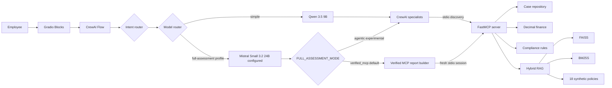

# Secure Enterprise AI Assistant

Local-first agentic AI decision support for **NovaBank Financial Services AG**, a fully
fictional financial-services organization. The project demonstrates how deterministic
business logic, Advanced RAG, Model Context Protocol (MCP), CrewAI specialists, evaluation,
and security controls fit together in one auditable application.

> **Synthetic-data disclaimer:** NovaBank does not exist. Every customer, case, policy,
> compliance rule, amount, label, and document in this repository was created solely for
> demonstration, testing, and portfolio use. This software is not financial or legal advice.

## Business context

Enterprise assistants must do more than generate plausible prose. A credit workflow needs
validated data, exact arithmetic, explicit policy evidence, constrained tool use, measurable
quality, and a reviewable execution path. This implementation keeps those concerns separate:
the language model explains and synthesizes, while MCP tools own facts, calculations,
compliance results, and retrieval. The fictional NovaBank scenario demonstrates decision
support for employees; it does not automate final credit approval.

## What is implemented

- 48 reproducible synthetic credit cases across eight risk scenarios;
- strict Pydantic domain models shared across services, MCP, agents, flows, UI, and evaluation;
- Decimal-based annuity, repayment, interest, and pre/post-loan DTI calculations;
- ten versioned JSON compliance rules built from nine allowlisted predicates, with policy
  references;
- 18 internally consistent synthetic NovaBank policies with document-control metadata;
- Markdown, text, and PDF ingestion with section/page provenance and safe path handling;
- hybrid retrieval (multilingual embeddings via Ollama + BM25S + identifier signal) with a
  persistent FAISS index, filters before ranking, and calibrated scope rejection;
- a real FastMCP server with four structured tools;
- native CrewAI stdio-MCP discovery with per-agent least-privilege tool filters;
- deterministic five-route classification, dual-model selection, and CrewAI Flow orchestration;
- case, financial, compliance, knowledge, and evidence-review specialists using local Ollama;
- a Gradio Blocks UI with sources, selected tools, trace, cases, documents, and diagnostics;
- a visible deterministic all-MCP demo-safe path for reproducible local full assessments;
- active input guardrails, sanitized errors, local runtime storage, and no arbitrary code tools;
- measured offline evaluation, unit/integration tests, CI, and a Docker entry point.

## Architecture




The agent never receives a direct Python business function. CrewAI discovers the four MCP
tools from a real local server, and each specialist sees only its allowlisted subset. Details
and trust boundaries are documented in [docs/architecture.md](docs/architecture.md).

## MCP tools

| Tool | Input | Structured output |
|---|---|---|
| `get_customer_case` | `case_id` | validated `CreditCase` |
| `analyze_financial_case` | `case_id` | deterministic `FinancialMetrics` |
| `check_compliance` | `case_id` | complete `ComplianceFinding` list |
| `search_internal_knowledge` | question + safe filters | ranked chunks with source metadata |

The interface exposes no SQL, shell, generic URL, or arbitrary filesystem capability.

## Agent and Flow design

The deterministic router selects the smallest sufficient route:

| Request type | Model profile | MCP path | CrewAI execution |
|---|---|---|---|
| Knowledge | `fast_local` / Qwen | knowledge search | Knowledge specialist |
| Customer case | `fast_local` / Qwen | case lookup | Case specialist |
| Financial | `fast_local` / Qwen | case + calculator | Financial analyst |
| Compliance | `fast_local` / Qwen | case + rules + policy | Compliance analyst |
| Full assessment | `complex_agentic` / Mistral configured | all four tools | Default: verified MCP report; opt-in: agentic CrewAI |

The deterministic model router performs no model call. It assigns full assessments to the
`complex_agentic` profile and records `mistral-small3.2:24b` as the configured complex model.
With the demo default `FULL_ASSESSMENT_MODE=verified_mcp`, the execution gate deliberately does
not start that model: it opens a fresh real MCP-stdio session, calls all four tools, and renders
a bounded German report as `deterministic_mcp_fallback`. The trace distinguishes a configured
model from an executed model and states the demo-safe reason explicitly.

`FULL_ASSESSMENT_MODE=agentic` retains the experimental native Mistral/CrewAI sequence for
later testing. Its strict evidence guardrails still switch to the same verified MCP path if the
crew fails or returns an incomplete report. Simple Qwen routes are unaffected. Neither mode
uses a direct Python-service bypass. This hardware-dependent local demo is not presented as a
production-ready decision system.

## Advanced RAG

The corpus is chunked by document section while preserving document ID, title, version,
effective date, owner, section, and page where available. Three signals are fused:

- **vector ranking** in FAISS with a local multilingual embedding model via Ollama (default
  `qwen3-embedding:0.6b`, chosen by measurement below);
- **lexical ranking** with BM25S and German stopwords;
- **identifier signal**: an explicitly named document ID (`NB-RSK-001`) and section number
  (`Abschnitt 7.4`) always rank first.

**Filters run before ranking.** Only permitted chunks are scored; BM25 term statistics are
computed on the permitted subset, so hidden documents cannot shift rank positions or the
"no answer" decision. A unit test compares the filtered ranking with a ranking built from the
permitted documents alone.

**Persistent index.** Vectors are stored in `<RUNTIME_DIR>/index/<embedder>/` with a manifest
(embedder, dimension, corpus hash, chunker version). A mismatch triggers a rebuild, never the
silent reuse of a stale index. `novabank-index rebuild` and `novabank-index status` manage it.
Building takes about 2 s for 76 chunks on an M4 Pro; loading takes about 0.02 s.

**No answer instead of a weak answer.** For semantic models, the out-of-scope threshold is
calibrated per model on the dev split only (`resources/retrieval/thresholds.json`).

### Before/after: hashing vs. real embedding models

Measured on 16.11.2026 on an Apple M4 Pro with `scripts/benchmark_retrieval.py`; full report in
`reports/evaluation/retrieval_comparison.json`. Test split: 20 answerable German questions
(paraphrases, compounds, document and section numbers) and 4 questions without an answer.

| Embedder | Recall@5 | MRR | nDCG@5 | No-answer correct | False rejections | Query latency |
|---|---:|---:|---:|---:|---:|---:|
| Hashing (v1 default) | 0.80 | 0.62 | 0.65 | 1.00 | 0.10 | 0.1 ms |
| bge-m3 | 1.00 | 0.91 | 0.92 | 1.00 | 0.00 | 25 ms |
| **qwen3-embedding:0.6b** (default) | **1.00** | **0.98** | **0.98** | **1.00** | **0.00** | 32 ms |
| embeddinggemma | 0.90 | 0.88 | 0.88 | 1.00 | 0.10 | 21 ms |

With 20 answerable questions, a difference of 0.10 in recall equals two questions. The suite was
written by the project author; it is a regression benchmark, not an independent one.

### Routing

Case-ID extraction is a rule (`CASE-00031`, `case-00031`, `Fall 31`). For case requests the
intent is chosen by a hybrid router: explicit keywords decide when present, otherwise the
request is compared with labelled example requests via embeddings (no language model call).
Measured with `scripts/benchmark_routing.py` (`reports/evaluation/routing_comparison.json`):

| Router | Dev | Test | Mean latency |
|---|---:|---:|---:|
| Keyword rules only (v1 approach, extended) | 25/25 | 22/24 | < 0.1 ms |
| Semantic only | 25/25 | 24/24 | 25 ms |
| **Hybrid** (default) | 25/25 | **24/24** | 8 ms |

The two keyword misses ("freigegeben", "umfassend") are words that occur only in the test split
and were deliberately not added to the rules. CI has no Ollama, so the offline evaluation below
reports the hashing and keyword baselines.

Retrieved content is explicitly treated as untrusted evidence, not instructions.

## Measured evaluation

The generated report at `reports/evaluation/latest.json` comes from the versioned suite shipped
inside the package at `src/secure_enterprise_ai_assistant/resources/evaluation/`. No benchmark
number is hand-written or inferred. The evidence check also verifies exact hashes for the suite,
cases, rules, and knowledge corpus.

| Metric | Result | Evaluation set |
|---|---:|---:|
| Routing accuracy, keyword baseline – test | 0.9167 | 24 queries |
| Financial exact match | 1.0000 | 5 cases × 5 metrics |
| Compliance-rule exact match | 1.0000 | 5 cases |
| Retrieval Recall@5, hashing baseline – test | 0.8000 | 20 answerable questions |
| Retrieval MRR, hashing baseline – test | 0.6183 | 20 answerable questions |
| No-answer accuracy, hashing baseline – test | 1.0000 | 4 questions |
| Guardrail attack recall – dev split | 1.0000 | 30 attacks |
| Guardrail false-positive rate – dev split | 0.0000 | 30 benign questions |
| Guardrail attack recall – **holdout split** | **0.7500** | 20 attacks |
| Guardrail false-positive rate – holdout split | 0.0000 | 20 benign questions |

This offline report runs in CI without Ollama, so retrieval and routing use the deterministic
hashing and keyword baselines; real-model results are in the tables above. The former
"tool-selection accuracy" and "source-attribution rate" were removed in v1.2 because they were
true by construction.

Measured on 16.11.2026 for v1.2.0. The guardrail dev split was used to design the patterns and
is optimistic by construction; the holdout split was written afterwards and measured without
tuning. Both splits come from the pattern author, so neither is an independent benchmark. The
holdout result (15 of 20 attacks blocked) is the honest estimate, and it is why the pattern
filter is only the first security layer.

These scores describe only a **synthetic offline benchmark** implemented as a deliberately small
regression suite. They do not measure real credit-decision accuracy, certify regulatory
compliance, or establish that the complete agentic pipeline is accurate. LLM-only comparison is
not part of this benchmark; measured live-model behavior is documented separately in
`docs/example-execution-trace.md`.

Two metrics carry little independent information, and the report says so in `metric_notes`:
tool-selection accuracy is derived from the routed intent and therefore equals routing accuracy,
and source attribution only checks that returned chunks carry metadata. The routing suite still
consists of the demo phrasings; it is extended in v1.2. The v1.0.2 audit probe
([docs/audit-v1.md](docs/audit-v1.md)) had measured 1 of 12 attack phrasings blocked.

## REST API and security (v1.3)

The FastAPI backend is the single entry point for the Gradio UI and for other systems (for
example PHP or Java applications). OpenAPI documentation is served at `/docs`.

| Endpoint | Purpose |
|---|---|
| `POST /v1/auth/token` | log in, returns a JWT (HS256, 15 minutes) |
| `GET /v1/me` | own role and rights |
| `GET /v1/cases`, `GET /v1/cases/{id}` | permitted cases |
| `GET /v1/cases/{id}/financials`, `/compliance` | deterministic metrics and rule results |
| `POST /v1/search` | knowledge search, filtered before ranking |
| `POST /v1/chat` | the assistant workflow |
| `GET /health`, `GET /ready` | liveness and readiness |

| Role | Cases | Documents | Decision brief |
|---|---|---|---|
| `sachbearbeiter` | own team only | `intern` | no (four-eyes principle) |
| `pruefer` | all | `intern`, `vertraulich` | yes |
| `admin` | all | `intern`, `vertraulich` | yes |

Authorization is enforced in code and inside every MCP tool, never in a prompt. The caller's
token travels from the API through the workflow into the MCP stdio subprocess, which verifies it
and scopes every tool call. A foreign case returns the same 404 as an unknown case; a
confidential document is excluded before ranking, so neither its rank nor a changed "no answer"
reveals it. Tests cover direct, filter-based, identifier-based and MCP-level detours
(`tests/security/`).

## Security controls

- JWT bearer authentication (fixed algorithm, issuer/audience/expiry required), Argon2id
  password hashes, users stored outside the repository with owner-only file permissions;
- role- and team-based authorization in code and in the MCP tools;
- knowledge filters before ranking, including BM25 statistics on the permitted subset;
- rate limits for login, chat and API calls; restrictive CORS (none by default);
- security headers (CSP, `nosniff`, `DENY` framing, `no-referrer`, `no-store`, optional HSTS);
- hash-chained audit log without passwords or query text (`novabank-audit verify`);
- RFC 9457 problem responses in German without internal details or echoed input;
- strict input and output schemas with forbidden extra fields;
- tool and per-agent allowlists; MCP subprocesses receive only allowlisted settings;
- a first-layer German/English prompt-injection filter with obfuscation normalization (holdout
  recall 0.75, no false positives on 50 benign questions), applied in the API and the workflow;
- safe knowledge-root containment and supported-extension checks;
- no secrets in the repository (`JWT_SECRET` has no default; the audit flags filled-in keys);
- CrewAI telemetry and remote tracing disabled by default; loopback binding by default;
- synthetic-data boundary repeated in data artifacts, policies, prompts, and UI.

See [docs/security.md](docs/security.md) for controls and known production gaps.

## Local setup

Requirements: Python 3.13 (`>=3.13,<3.14`), Ollama, and sufficient memory for the chosen
local model. Python 3.13.9 is the reproducibly validated runtime for release v1.3.0.

```bash
python3.13 -m venv .venv
source .venv/bin/activate
python -m pip install --upgrade pip
python -m pip install --no-deps -r requirements/lock-py313.txt
python -m pip install --no-deps --no-build-isolation .
cp .env.example .env
ollama pull qwen3.5:9b
ollama pull qwen3-embedding:0.6b
novabank-index rebuild
# Only required for experimental FULL_ASSESSMENT_MODE=agentic:
ollama pull mistral-small3.2:24b
```

Rebuild all synthetic source artifacts:

```bash
python scripts/generate_synthetic_data.py
python scripts/generate_knowledge_base.py
```

Create users (the password is prompted, never stored in plain text) and start API and UI:

```bash
export JWT_SECRET=$(python -c 'import secrets; print(secrets.token_urlsafe(48))')
novabank-users add anna.becker --role pruefer --name "Anna Becker"
novabank-users add max.muster --role sachbearbeiter --team team-nord
novabank-api      # http://127.0.0.1:8000, OpenAPI at /docs
novabank-ui       # http://127.0.0.1:7860, logs in at the API
```

The MCP server is launched automatically per request with the caller's token; it can be
inspected separately with `novabank-mcp` over stdio (without a token every call is denied).

## Container usage

The application image contains the Python service, synthetic data, and MCP implementation. It
does not bundle Ollama or either model. Build the image and point it to an Ollama daemon running
on the host. The Linux image installs the official CPU-only PyTorch wheel so it does not pull
unused CUDA runtime packages:

```bash
docker build -t novabank-assistant .
docker run --rm -p 7860:7860 \
  -e OLLAMA_BASE_URL=http://host.docker.internal:11434 \
  novabank-assistant
```

On Linux, configure an equivalent reachable Ollama host address for the container.

## Quality checks

```bash
make quality        # strict mypy, Ruff lint and format check
make test           # pytest with warnings as errors and a coverage floor
make evidence-check
make audit
make deps-audit     # pip-audit against the exact lock (needs pipx; or PIP_AUDIT="uvx pip-audit==2.10.1")
python -m pip check
make reproduce-evidence
make build
```

The full test suite does not need a running model or network connection. End-to-end generation
does require the configured Ollama server and model.

Current local release gate: **274 tests passing** under Python 3.13 with warnings treated as
errors. CI installs the package non-editably and proves that imports resolve from
`site-packages`.

## Demo path

1. Ask: `Welche Unterlagen benötigt NovaBank für einen Konsumentenkredit?`
2. Load the positive `CASE-00001` and calculate its EUR 419.46 monthly payment.
3. Inspect `CASE-00017`, where the income statement is missing.
4. Fully assess borderline `CASE-00031`; post-loan DTI triggers manual review.
5. Contrast `CASE-00007` (DTI hard limit) or `CASE-00008` (rejected KYC / class E).

Expected routes and evidence are listed in [docs/demo-scenarios.md](docs/demo-scenarios.md).
An actual local run, including transparent fail-safe behavior, is recorded in
[docs/example-execution-trace.md](docs/example-execution-trace.md).

## UI evidence

The screenshots use synthetic data and show only technical execution metadata—never private
chain-of-thought.


## Repository map

```text
docs/                 architecture, security, demo guidance, audit, and v2 plan
reports/evaluation/   measured evaluation output
requirements/         exact Python 3.13 dependency lock and lock policy
scripts/              thin repository wrappers for generation, evidence, and audit
src/.../resources/    packaged synthetic cases, rules, policies, and evaluation suite
src/.../agents/       CrewAI specialists and MCP configuration
src/.../flows/        deterministic router and CrewAI Flow
src/.../mcp/          FastMCP server and defensive tool boundary
src/.../rag/          ingestion, FAISS/BM25S hybrid retrieval
src/.../services/     deterministic repository, finance, and compliance logic
src/.../ui/           Gradio Blocks application
tests/                unit and integration regression suite
```

## Limitations and roadmap

- The committed regression suite is intentionally compact and synthetic.
- End-to-end answer quality and latency depend on the locally selected Ollama model.
- Security limits of v1.3: one shared HS256 key instead of an identity provider (OAuth 2.1/OIDC,
  SSO), users in a JSON file, in-memory rate limits per process, no TLS termination (belongs to
  a reverse proxy), and an audit log that is tamper-evident, not tamper-proof. Encrypted
  storage, malware scanning, distributed tracing, and formal regulatory validation remain
  production work.
- A larger adversarial corpus, a cross-encoder reranker, and a measured LLM/RAG/agentic
  baseline comparison are logical next steps after choosing final local-model hardware.
- One dependency exception is open: `chromadb` (pulled in only by CrewAI, unused by this
  package) has known vulnerabilities without a fixed release. It is ignored explicitly in
  `make deps-audit` and disappears when CrewAI is replaced (planned v1.4).
- The v2.0 roadmap with its work packages is in [docs/plan-v2.md](docs/plan-v2.md); the audit of
  v1.0.2 is in [docs/audit-v1.md](docs/audit-v1.md).

## License and responsible use

No real bank policies or customer data are included. Original repository code and documentation
are available under the [MIT License](LICENSE); model, model-server, dependency, and externally
supplied document licenses remain separate. See [RESPONSIBLE_USE.md](RESPONSIBLE_USE.md) and
[SECURITY.md](SECURITY.md).
