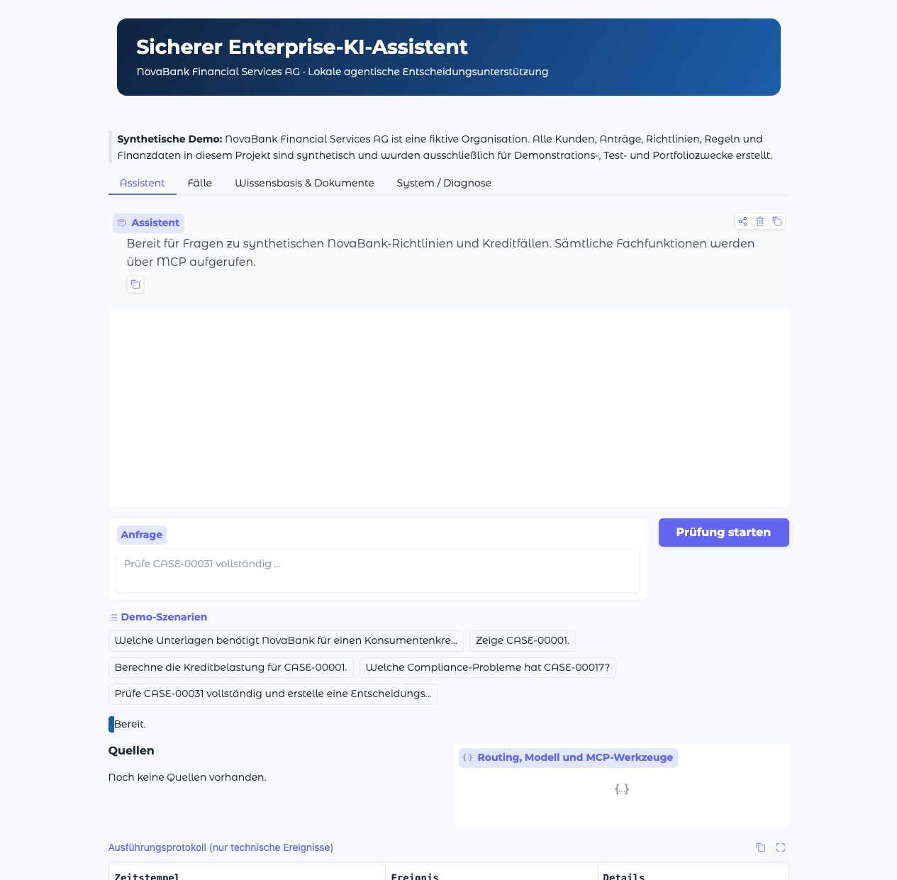
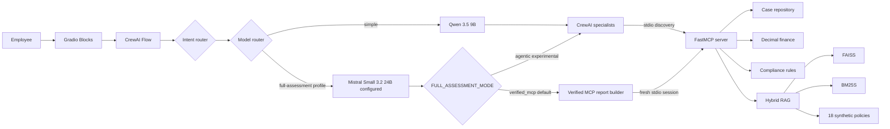
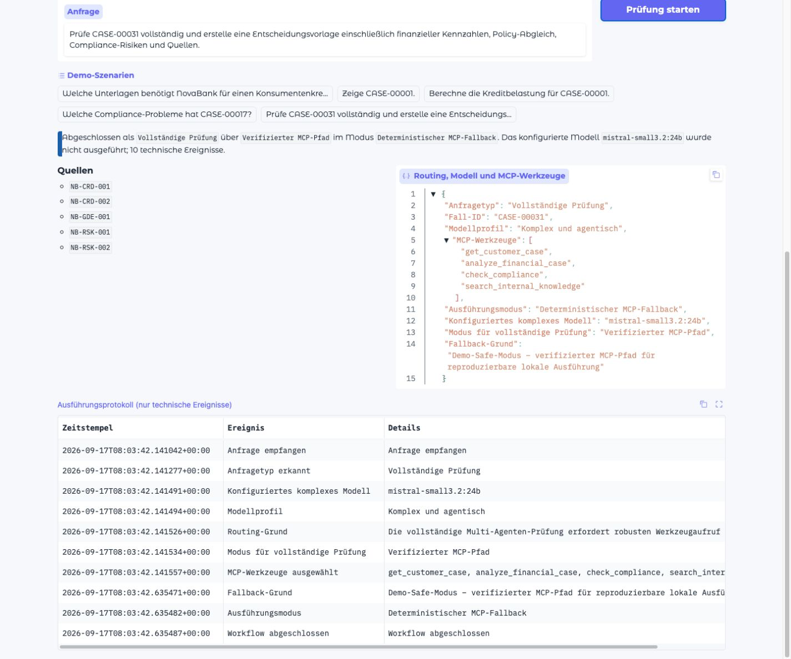

# Secure Enterprise AI Assistant

Local-first agentic AI decision support for **NovaBank Financial Services AG**, a fully
fictional financial-services organization. The project demonstrates how deterministic
business logic, Advanced RAG, Model Context Protocol (MCP), CrewAI specialists, evaluation,
and security controls fit together in one auditable application.

> **Synthetic-data disclaimer:** NovaBank does not exist. Every customer, case, policy,
> compliance rule, amount, label, and document in this repository was created solely for
> demonstration, testing, and portfolio use. This software is not financial or legal advice.

## Business context

Enterprise assistants must do more than generate plausible prose. A credit workflow needs
validated data, exact arithmetic, explicit policy evidence, constrained tool use, measurable
quality, and a reviewable execution path. This implementation keeps those concerns separate:
the language model explains and synthesizes, while MCP tools own facts, calculations,
compliance results, and retrieval. The fictional NovaBank scenario demonstrates decision
support for employees; it does not automate final credit approval.

## What is implemented

- 48 reproducible synthetic credit cases across eight risk scenarios;
- strict Pydantic domain models shared across services, MCP, agents, flows, UI, and evaluation;
- Decimal-based annuity, repayment, interest, and pre/post-loan DTI calculations;
- ten versioned JSON compliance rules built from nine allowlisted predicates, with policy
  references;
- 18 internally consistent synthetic NovaBank policies with document-control metadata;
- Markdown, text, and PDF ingestion with section/page provenance and safe path handling;
- FAISS + BM25S rank fusion, metadata filters, and scope rejection (with the default hashing
  embedder both rankings are lexical; see [Advanced RAG](#advanced-rag));
- a real FastMCP server with four structured tools;
- native CrewAI stdio-MCP discovery with per-agent least-privilege tool filters;
- deterministic five-route classification, dual-model selection, and CrewAI Flow orchestration;
- case, financial, compliance, knowledge, and evidence-review specialists using local Ollama;
- a Gradio Blocks UI with sources, selected tools, trace, cases, documents, and diagnostics;
- a visible deterministic all-MCP demo-safe path for reproducible local full assessments;
- active input guardrails, sanitized errors, local runtime storage, and no arbitrary code tools;
- measured offline evaluation, unit/integration tests, CI, and a Docker entry point.

## Architecture





The agent never receives a direct Python business function. CrewAI discovers the four MCP
tools from a real local server, and each specialist sees only its allowlisted subset. Details
and trust boundaries are documented in [docs/architecture.md](docs/architecture.md).

## MCP tools

| Tool | Input | Structured output |
|---|---|---|
| `get_customer_case` | `case_id` | validated `CreditCase` |
| `analyze_financial_case` | `case_id` | deterministic `FinancialMetrics` |
| `check_compliance` | `case_id` | complete `ComplianceFinding` list |
| `search_internal_knowledge` | question + safe filters | ranked chunks with source metadata |

The interface exposes no SQL, shell, generic URL, or arbitrary filesystem capability.

## Agent and Flow design

The deterministic router selects the smallest sufficient route:

| Request type | Model profile | MCP path | CrewAI execution |
|---|---|---|---|
| Knowledge | `fast_local` / Qwen | knowledge search | Knowledge specialist |
| Customer case | `fast_local` / Qwen | case lookup | Case specialist |
| Financial | `fast_local` / Qwen | case + calculator | Financial analyst |
| Compliance | `fast_local` / Qwen | case + rules + policy | Compliance analyst |
| Full assessment | `complex_agentic` / Mistral configured | all four tools | Default: verified MCP report; opt-in: agentic CrewAI |

The deterministic model router performs no model call. It assigns full assessments to the
`complex_agentic` profile and records `mistral-small3.2:24b` as the configured complex model.
With the demo default `FULL_ASSESSMENT_MODE=verified_mcp`, the execution gate deliberately does
not start that model: it opens a fresh real MCP-stdio session, calls all four tools, and renders
a bounded German report as `deterministic_mcp_fallback`. The trace distinguishes a configured
model from an executed model and states the demo-safe reason explicitly.

`FULL_ASSESSMENT_MODE=agentic` retains the experimental native Mistral/CrewAI sequence for
later testing. Its strict evidence guardrails still switch to the same verified MCP path if the
crew fails or returns an incomplete report. Simple Qwen routes are unaffected. Neither mode
uses a direct Python-service bypass. This hardware-dependent local demo is not presented as a
production-ready decision system.

## Advanced RAG

The corpus is chunked by document section while preserving document ID, title, version,
effective date, owner, section, and page where available. A vector ranking uses FAISS, a
lexical ranking uses BM25S, and reciprocal-rank fusion combines both.

**Honest scope of the default configuration:** the default embedder is a deterministic hashing
bag-of-words, not a semantic model. In this mode both rankings are lexical, so the system does
not yet perform meaning-based retrieval. Knowledge base, rules, prompts, and UI are German since
v1.1. A semantic multilingual embedder is planned for v1.2 (see
[docs/plan-v2.md](docs/plan-v2.md)); the retriever already accepts one through its embedder
interface.

Retrieval does not equate nearest with relevant: weak matches produce `out_of_scope=true` and
no passages. Retrieved content is explicitly treated as untrusted evidence, not instructions.

## Measured evaluation

The generated report at `reports/evaluation/latest.json` comes from the versioned suite shipped
inside the package at `src/secure_enterprise_ai_assistant/resources/evaluation/`. No benchmark
number is hand-written or inferred. The evidence check also verifies exact hashes for the suite,
cases, rules, and knowledge corpus.

| Metric | Result | Evaluation set |
|---|---:|---:|
| Routing accuracy | 1.0000 | 10 queries |
| Tool-selection accuracy | 1.0000 | 10 queries |
| Financial exact match | 1.0000 | 5 cases × 5 metrics |
| Compliance-rule exact match | 1.0000 | 5 cases |
| Retrieval Recall@5 (German questions, hashing embedder) | 0.8000 | 5 questions |
| Source-attribution rate | 0.8000 | 5 questions |
| Out-of-scope accuracy | 1.0000 | 3 questions |
| Guardrail attack recall – dev split | 1.0000 | 30 attacks |
| Guardrail false-positive rate – dev split | 0.0000 | 30 benign questions |
| Guardrail attack recall – **holdout split** | **0.7500** | 20 attacks |
| Guardrail false-positive rate – holdout split | 0.0000 | 20 benign questions |

Measured on 16.11.2026 for v1.1.0. The guardrail dev split was used to design the patterns and
is optimistic by construction; the holdout split was written afterwards and measured without
tuning. Both splits come from the pattern author, so neither is an independent benchmark. The
holdout result (15 of 20 attacks blocked) is the honest estimate, and it is why the pattern
filter is only the first security layer. Since v1.1 the knowledge base is German and the former
eight-term query-expansion map is gone; the remaining retrieval miss is a German compound
("Pflichtunterlagen" vs. "Pflichtnachweise") that lexical hashing cannot bridge. Semantic
embeddings follow in v1.2.

These scores describe only a **synthetic offline benchmark** implemented as a deliberately small
regression suite. They do not measure real credit-decision accuracy, certify regulatory
compliance, or establish that the complete agentic pipeline is accurate. LLM-only comparison is
not part of this benchmark; measured live-model behavior is documented separately in
`docs/example-execution-trace.md`.

Two metrics carry little independent information, and the report says so in `metric_notes`:
tool-selection accuracy is derived from the routed intent and therefore equals routing accuracy,
and source attribution only checks that returned chunks carry metadata. The routing suite still
consists of the demo phrasings; it is extended in v1.2. The v1.0.2 audit probe
([docs/audit-v1.md](docs/audit-v1.md)) had measured 1 of 12 attack phrasings blocked.

## Security controls

- strict input and output schemas with forbidden extra fields;
- tool and per-agent allowlists;
- a first-layer German/English prompt-injection filter with obfuscation normalization (holdout
  recall 0.75, no false positives on 50 benign questions);
- safe knowledge-root containment and supported-extension checks;
- no secrets, production customer data, arbitrary SQL, shell, or model-written arithmetic;
- error sanitization at the UI boundary;
- CrewAI telemetry and remote tracing disabled by default;
- local CrewAI runtime storage in the platform-specific per-user state directory;
- loopback UI binding and Gradio sharing disabled by default;
- synthetic-data boundary repeated in data artifacts, policies, prompts, and UI.

See [docs/security.md](docs/security.md) for controls and known production gaps.

## Local setup

Requirements: Python 3.13 (`>=3.13,<3.14`), Ollama, and sufficient memory for the chosen
local model. Python 3.13.9 is the reproducibly validated runtime for release v1.1.0.

```bash
python3.13 -m venv .venv
source .venv/bin/activate
python -m pip install --upgrade pip
python -m pip install --no-deps -r requirements/lock-py313.txt
python -m pip install --no-deps --no-build-isolation .
cp .env.example .env
ollama pull qwen3.5:9b
# Only required for experimental FULL_ASSESSMENT_MODE=agentic:
ollama pull mistral-small3.2:24b
```

Rebuild all synthetic source artifacts:

```bash
python scripts/generate_synthetic_data.py
python scripts/generate_knowledge_base.py
```

Start the interface:

```bash
novabank-ui
```

Open `http://127.0.0.1:7860`. The MCP server is normally launched automatically by CrewAI,
but it can be inspected separately with `novabank-mcp` over stdio.

## Container usage

The application image contains the Python service, synthetic data, and MCP implementation. It
does not bundle Ollama or either model. Build the image and point it to an Ollama daemon running
on the host. The Linux image installs the official CPU-only PyTorch wheel so it does not pull
unused CUDA runtime packages:

```bash
docker build -t novabank-assistant .
docker run --rm -p 7860:7860 \
  -e OLLAMA_BASE_URL=http://host.docker.internal:11434 \
  novabank-assistant
```

On Linux, configure an equivalent reachable Ollama host address for the container.

## Quality checks

```bash
make quality        # strict mypy, Ruff lint and format check
make test           # pytest with warnings as errors and a coverage floor
make evidence-check
make audit
make deps-audit     # pip-audit against the exact lock (needs pipx; or PIP_AUDIT="uvx pip-audit==2.10.1")
python -m pip check
make reproduce-evidence
make build
```

The full test suite does not need a running model or network connection. End-to-end generation
does require the configured Ollama server and model.

Current local release gate: **190 tests passing** under Python 3.13 with warnings treated as
errors. CI installs the package non-editably and proves that imports resolve from
`site-packages`.

## Demo path

1. Ask: `Welche Unterlagen benötigt NovaBank für einen Konsumentenkredit?`
2. Load the positive `CASE-00001` and calculate its EUR 419.46 monthly payment.
3. Inspect `CASE-00017`, where the income statement is missing.
4. Fully assess borderline `CASE-00031`; post-loan DTI triggers manual review.
5. Contrast `CASE-00007` (DTI hard limit) or `CASE-00008` (rejected KYC / class E).

Expected routes and evidence are listed in [docs/demo-scenarios.md](docs/demo-scenarios.md).
An actual local run, including transparent fail-safe behavior, is recorded in
[docs/example-execution-trace.md](docs/example-execution-trace.md).

## UI evidence

The screenshots use synthetic data and show only technical execution metadata—never private
chain-of-thought.



## Repository map

```text
docs/                 architecture, security, demo guidance, audit, and v2 plan
reports/evaluation/   measured evaluation output
requirements/         exact Python 3.13 dependency lock and lock policy
scripts/              thin repository wrappers for generation, evidence, and audit
src/.../resources/    packaged synthetic cases, rules, policies, and evaluation suite
src/.../agents/       CrewAI specialists and MCP configuration
src/.../flows/        deterministic router and CrewAI Flow
src/.../mcp/          FastMCP server and defensive tool boundary
src/.../rag/          ingestion, FAISS/BM25S hybrid retrieval
src/.../services/     deterministic repository, finance, and compliance logic
src/.../ui/           Gradio Blocks application
tests/                unit and integration regression suite
```

## Limitations and roadmap

- The committed regression suite is intentionally compact and synthetic.
- The default hashing embedder is an offline bootstrap, not a multilingual production model.
- End-to-end answer quality and latency depend on the locally selected Ollama model.
- Authentication, role-based authorization, encrypted storage, malware scanning, distributed
  tracing, and formal regulatory validation remain production work.
- A larger adversarial corpus, reranker, persistent vector index, and measured LLM/RAG/agentic
  baseline comparison are logical next steps after choosing final local-model hardware.
- One dependency exception is open: `chromadb` (pulled in only by CrewAI, unused by this
  package) has known vulnerabilities without a fixed release. It is ignored explicitly in
  `make deps-audit` and disappears when CrewAI is replaced (planned v1.4).
- The v2.0 roadmap with its work packages is in [docs/plan-v2.md](docs/plan-v2.md); the audit of
  v1.0.2 is in [docs/audit-v1.md](docs/audit-v1.md).

## License and responsible use

No real bank policies or customer data are included. Original repository code and documentation
are available under the [MIT License](LICENSE); model, model-server, dependency, and externally
supplied document licenses remain separate. See [RESPONSIBLE_USE.md](RESPONSIBLE_USE.md) and
[SECURITY.md](SECURITY.md).
