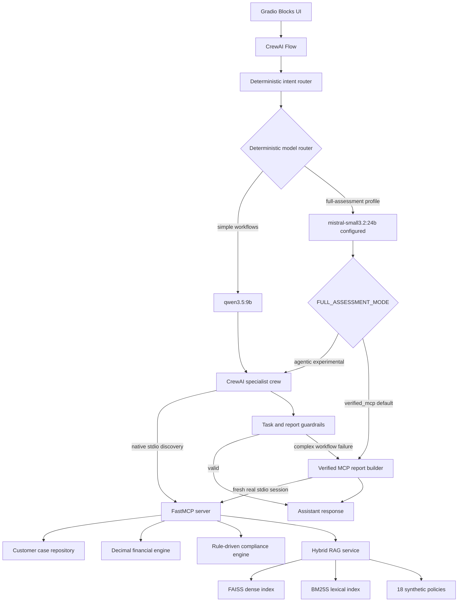

# Architecture

## Trust boundaries

The UI validates untrusted input before routing. Agents have no code execution and receive
least-privilege MCP tool filters. The MCP boundary validates identifiers, query length, and
metadata filters. File ingestion accepts only `.md`, `.txt`, and `.pdf` below the configured
knowledge root. Retrieved text is evidence, never an instruction channel.

## Routing

The intent router selects one of five routes: knowledge, customer case, financial analysis,
compliance check, or full assessment. A second deterministic router maps knowledge, case,
financial, and compliance workflows to the `fast_local` Qwen profile, while full assessment
maps to the `complex_agentic` Mistral profile. Unknown future simple intents default safely to
Qwen. Neither routing step invokes an LLM.

For ordinary routes the model is selected before CrewAI constructs a crew, and every agent in
that run receives the same LLM instance. For full assessment, the profile and configured model
are selected first, then the execution-mode gate runs. The Flow records only technical events:
request receipt, intent, executed or configured model, profile, routing reason, selected MCP
tools, optional sanitized fallback reason, execution mode, and completion.

## Local model and storage

Generation uses an Ollama-compatible endpoint with centrally configured temperature, token
limit, request timeout, and thinking mode. `OLLAMA_FAST_MODEL` and `OLLAMA_COMPLEX_MODEL`
configure the profiles; `FULL_ASSESSMENT_MODE` accepts `verified_mcp` (the demo default) or
`agentic`. The legacy `OLLAMA_MODEL` environment variable remains a fallback alias for the
fast profile. CrewAI task-output SQLite state is deliberately
relocated from the operating-system user directory to git-ignored `runtime/crewai/`. The default
retriever boots offline with deterministic hashing; deployments can set a locally installed
Sentence Transformer through the existing embedder abstraction.

For a full assessment, the default demo-safe mode invokes the deterministic verifier immediately;
Mistral is not started. The verifier obtains all four structured results through one real stdio
MCP client session and renders a bounded German report. The Flow records this transparently as
`deterministic_mcp_fallback` with the demo-safe reason. The `agentic` mode keeps the experimental
Mistral workflow and its reviewer/intermediate guardrails; terminal or completeness failure uses
the same verifier. This path is limited to full assessments, does not replace ordinary Qwen
CrewAI routes, and cannot access business services directly.
