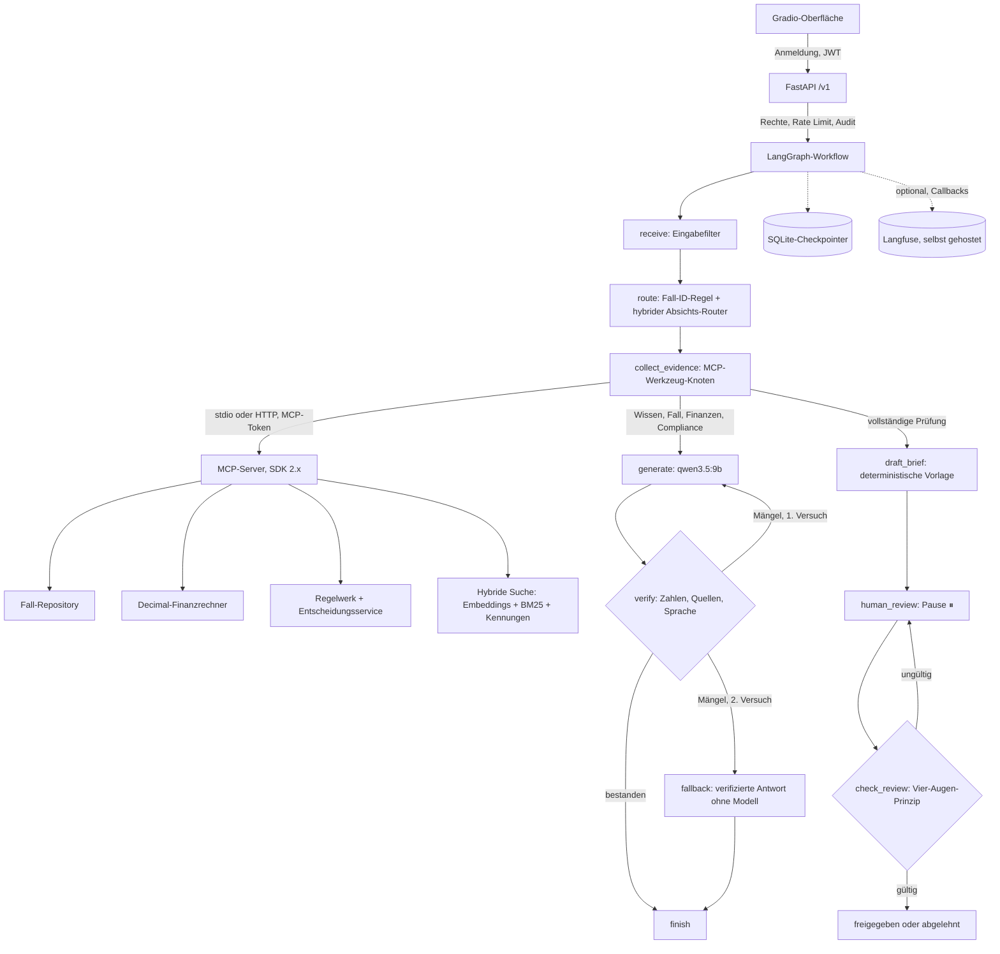

# Architektur

## Grundsätze

1. **Fakten kommen aus Code, Sprache aus dem Modell.** Fallakten, Rechnungen, Regelergebnisse und Empfehlungen liefern deterministische Services hinter MCP. Das Sprachmodell formuliert nur.
2. **Das Modell wählt keine Werkzeuge („Least Agency“).** Der Router legt den Werkzeugplan fest, der Werkzeug-Knoten führt ihn über MCP aus. Ein eingeschleuster Text in einem Dokument kann deshalb keinen Werkzeugaufruf auslösen.
3. **Jede Antwort wird geprüft.** Zahlen und Dokument-IDs müssen in den Nachweisen stehen, Richtlinienaussagen brauchen eine Quelle, und englische Beschriftungen sind verboten. Bei Mängeln gibt es einen zweiten Versuch mit Rückmeldung, danach den verifizierten Rückfallweg.
4. **Entscheidungsvorlagen schreibt kein Modell.** Sie werden aus MCP-Daten gerendert und pausieren, bis eine **zweite** prüfende Person freigibt oder ablehnt.
5. **Rechte werden im Code geprüft, mehrfach.** Die API prüft, der Graph prüft (Vorlage, Freigabe), und jedes MCP-Werkzeug prüft mit dem Token des Aufrufers.

## Vertrauensgrenzen

| Grenze | Schutz |
|---|---|
| Browser → API | JWT, Rate Limit, CORS geschlossen, Sicherheitsheader, Eingabefilter |
| API → Graph | Principal und Token als Laufzeit-Kontext (nicht im Checkpoint) |
| API → MCP-Token | eigenes Token mit Audience `novabank-mcp`, 5 Minuten; das API-Token wird nie weitergereicht |
| Graph → MCP | stdio: Unterprozess mit Positivliste und `NOVABANK_ACCESS_TOKEN`; HTTP: Bearer-Token, Prüfung je Anfrage (Resource Server) |
| MCP → Daten | Rechteprüfung je Werkzeug; Filter vor dem Ranking; fremde Fälle wie unbekannte |
| Dokumente → Modell | Dokumenttext als markierte Daten (`<richtlinie>`), Quarantäne bei Injektionsmustern |
| Modell → Nutzer | deterministische Antwortprüfung, Rückfallweg, Quellen nur aus Nachweisen |

## Zustand und Persistenz

- **Graph-Zustand:** SQLite-Checkpointer unter `<RUNTIME_DIR>/graph/checkpoints.sqlite`. Offene Freigaben überstehen einen Neustart der API. Ein Test sucht das Token in der Datenbank und findet es nicht.
- **Offene Freigaben:** kleiner Index `<RUNTIME_DIR>/graph/reviews.json`, der Entwurf selbst steckt im Checkpoint.
- **Suchindex:** `<RUNTIME_DIR>/index/<embedder>/` mit Manifest.
- **Benutzer und Audit-Log:** `<RUNTIME_DIR>/security/users.json` (nur Argon2id-Hashes) und `<RUNTIME_DIR>/audit/audit.jsonl` (Hash-Kette).

## Beobachtbarkeit (optional)

Mit `LANGFUSE_ENABLED=true` wird jeder Lauf ein Trace in einem selbst gehosteten Langfuse: jeder Graph-Knoten als Span, der Modellaufruf als Generation mit Prompt, Antwort und Token, Nutzer pseudonymisiert, Thread als Sitzung. Kosten rechnet Langfuse aus einer Modelldefinition mit einstellbarem Preis (`novabank-langfuse einrichten`). Ohne Schalter und Schlüssel wird kein Client erzeugt.

## Auslieferung

`compose.yaml` startet API und Oberfläche aus einem Image (Befehle `novabank-api`, `novabank-ui`, optional `novabank-mcp --transport http` im Profil `mcp-http`). Ollama läuft nativ auf dem Host; nur dort nutzt es auf dem Mac die GPU. Alle Ports sind nur an `127.0.0.1` gebunden, die Container laufen schreibgeschützt und ohne Linux-Capabilities.

## Modelle

| Aufgabe | Modell | Warum |
|---|---|---|
| Antworten | `qwen3.5:9b` über Ollama | größtes erlaubtes Modell auf 24 GB RAM; alle Routen nutzen dasselbe Modell |
| Embeddings | `qwen3-embedding:0.6b` über Ollama | in der Messung bestes Modell (MRR 0,98), klein |
| Absichtserkennung | dieselben Embeddings, Beispielsätze | kein Sprachmodell nötig, 8 ms |
| Richter in der Evaluation | `qwen3.5:9b`, Temperatur 0, JSON | lokal; als Richter schwach, deshalb Stichprobe von Hand |

Das frühere 24B-Profil (Mistral Small) ist entfernt: Es lag über der Hardware-Grenze und wurde im Standardmodus ohnehin nicht ausgeführt.
