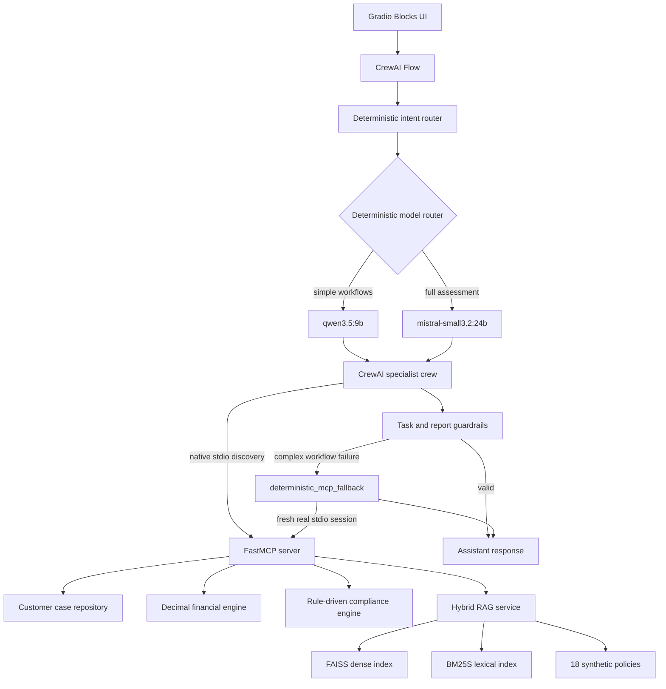

# Architecture

## Trust boundaries

The UI validates untrusted input before routing. Agents have no code execution and receive
least-privilege MCP tool filters. The MCP boundary validates identifiers, query length, and
metadata filters. File ingestion accepts only `.md`, `.txt`, and `.pdf` below the configured
knowledge root. Retrieved text is evidence, never an instruction channel.

## Routing

The intent router selects one of five routes: knowledge, customer case, financial analysis,
compliance check, or full assessment. A second deterministic router maps knowledge, case,
financial, and compliance workflows to the `fast_local` Qwen profile, while full assessment
maps to the `complex_agentic` Mistral profile. Unknown future simple intents default safely to
Qwen. Neither routing step invokes an LLM.

The model is selected before CrewAI constructs a crew. Every agent in that crew run receives
the same LLM instance, avoiding model swapping inside a multi-agent assessment. CrewAI Flow
records only technical events: request receipt, classified intent, selected model, profile,
routing reason, selected MCP tools, optional sanitized fallback reason, execution mode, and
completion.

## Local model and storage

Generation uses an Ollama-compatible endpoint with centrally configured temperature, token
limit, request timeout, and thinking mode. `OLLAMA_FAST_MODEL` and `OLLAMA_COMPLEX_MODEL`
configure the profiles; the legacy `OLLAMA_MODEL` environment variable remains a fallback
alias for the fast profile. CrewAI task-output SQLite state is deliberately
relocated from the operating-system user directory to git-ignored `runtime/crewai/`. The default
retriever boots offline with deterministic hashing; deployments can set a locally installed
Sentence Transformer through the existing embedder abstraction.

For a full assessment, reviewer and intermediate Task guardrails reject incomplete model output.
If the local model fails terminally, a deterministic verifier obtains the same four structured
results through a real stdio MCP client and renders a bounded report. The Flow records this as
`deterministic_mcp_fallback`; no direct Python-service bypass is used.

The fallback is limited to complex full assessments. It does not silently replace ordinary
CrewAI routes, and it cannot access business services directly: its only evidence path is a new
MCP client session over stdio.
