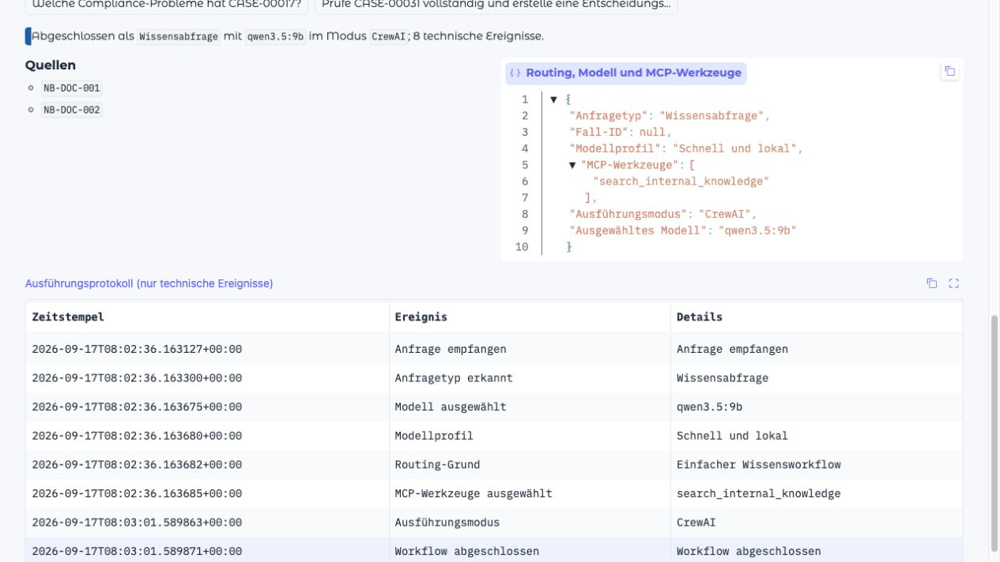
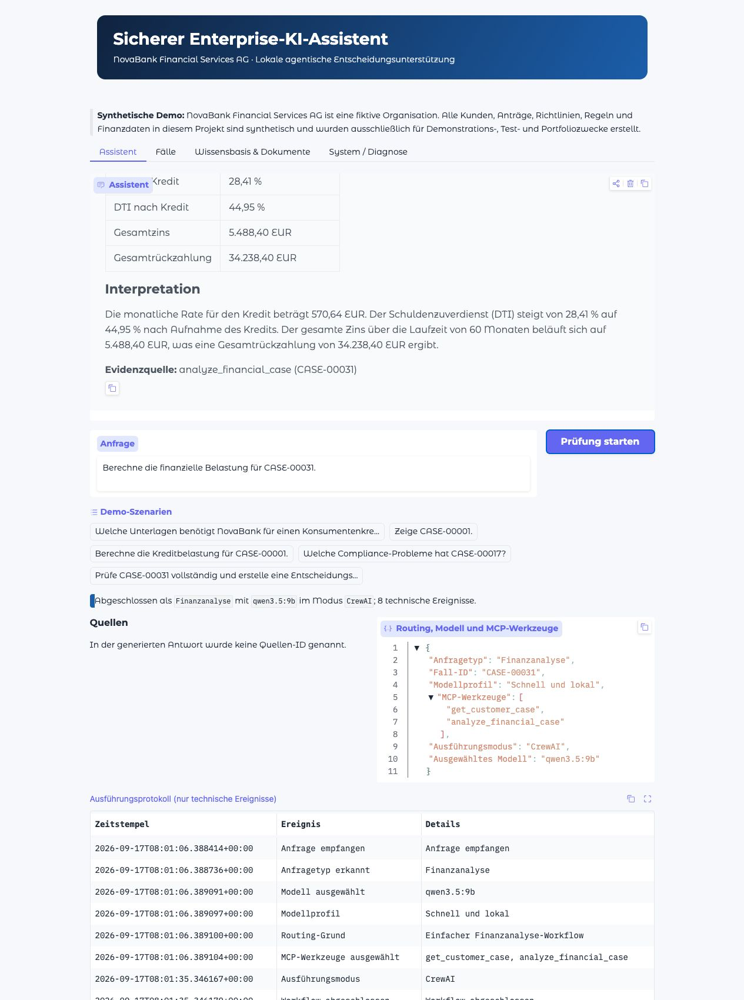
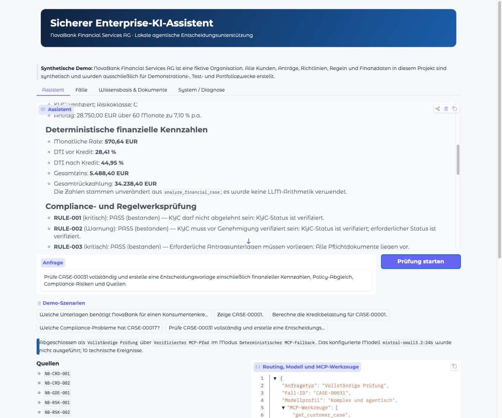

# Secure Enterprise AI Assistant

> **Historischer Stand (v1.0.2, Abschlussprojekt).** Dieses Dokument beschreibt die erste Version mit CrewAI und einem 24B-Mistral-Profil. Beides wurde in v1.4 durch einen LangGraph-Workflow mit einem lokalen 9B-Modell ersetzt. Aktuell gelten [README](../README.md) und [Architektur](architecture.md).

## Projektdokumentation zum Abschlussprojekt „NLP & Generative AI“

**Technischer Stand:** `v1.0.2`
**Fiktiver Business-Kontext:** NovaBank Financial Services AG

> **Hinweis zu Daten und Einsatzbereich:** NovaBank Financial Services AG ist vollständig
> fiktiv. Sämtliche Kunden-, Kredit-, Policy-, Regel- und Evaluationsdaten dieses Projekts
> sind synthetisch. Die Anwendung ist eine technische Demonstration und weder eine reale
> Bankenlösung noch eine Finanz- oder Rechtsberatung.

## 1. Projektübersicht

### Was wurde gebaut?

Der **Secure Enterprise AI Assistant** ist ein lokaler KI-Assistent für die vollständig fiktive
**NovaBank Financial Services AG**. Er demonstriert, wie generative KI mit strukturierten
Falldaten, Unternehmenswissen, deterministischen Berechnungen, Compliance-Regeln und
kontrolliertem Tool-Zugriff verbunden werden kann. Beschäftigte können Fälle analysieren,
interne Richtlinien durchsuchen und eine nachvollziehbare Entscheidungsvorlage erzeugen lassen.

Das Sprachmodell formuliert und strukturiert die Antwort. Verbindliche Fakten entstehen in
validierten Komponenten: Falldaten kommen aus dem lokalen Repository, Finanzwerte aus der
Financial Engine, Regelbefunde aus der Compliance Engine und Policy-Aussagen aus dem RAG-System.
Alle fachlichen Fähigkeiten sind ausschließlich über MCP-Werkzeuge erreichbar.

### Fiktiver Kontext und synthetische Daten

NovaBank ist keine reale Bank. Das Projekt verarbeitet keine realen Kunden-, Finanz- oder
Unternehmensdaten. Eigens für den Demonstrator wurden erstellt:

- **48 fiktive Kreditfälle** mit synthetischen Kundenprofilen und Kreditanträgen;
- **18 fiktive interne Richtlinien und Wissensdokumente**;
- ein versioniertes synthetisches Compliance-Regelwerk;
- synthetische Ground-Truth-Daten für reproduzierbare Evaluationen;
- stabile Demonstrationsfälle für Finanzanalyse, Compliance und Full Assessment.

### Projektziel

Das System soll Kreditfälle analysieren, finanzielle Kennzahlen exakt berechnen, interne
Policies durchsuchen, Compliance-Regeln vollständig prüfen und Quellen transparent belegen.
Es soll strukturierte Entscheidungsvorlagen erzeugen, lokale LLMs passend zum Workflow routen,
Tools ausschließlich kontrolliert über MCP verwenden und unvollständige oder unbelegte
Modellausgaben durch Guardrails beziehungsweise einen verifizierten MCP-Pfad abfangen.

## 2. Ausgangssituation und Problemstellung

Generative KI kann fachliche Informationen verständlich zusammenfassen, arbeitet aber ohne
zusätzliche Kontrollen probabilistisch. In einem kreditnahen Unternehmensprozess reicht eine
plausibel klingende Antwort deshalb nicht aus: Falldaten müssen validiert, Berechnungen exakt
reproduziert, Regeln vollständig angewendet und Aussagen mit nachvollziehbaren Quellen belegt
werden. Gleichzeitig sollen sensible Unternehmensinformationen lokal verarbeitet werden und
Werkzeugzugriffe klar begrenzt bleiben.

Ein klassischer RAG-Chatbot kann Dokumente finden und daraus Text erzeugen. Er löst jedoch nicht
automatisch die Trennung zwischen Sprachgenerierung und fachlicher Entscheidungslogik. Besonders
kritisch sind frei gerechnete Finanzwerte, unvollständige Compliance-Prüfungen, erfundene
Schwellenwerte, nicht nachvollziehbare Quellen und versteckte Direktzugriffe auf interne
Services. Zusätzlich können lokale Modelle je nach Hardware und Workflow sehr unterschiedliche
Laufzeiten und Tool-Calling-Eigenschaften zeigen.

## 3. Projektziele

Das Projekt wurde bewusst als mehrschichtige Plattform und nicht nur als einfacher
RAG-Chatbot umgesetzt. Die zentralen Ziele sind:

- **Lokale LLM-Ausführung:** Antworten werden über lokal betriebene Ollama-Modelle erzeugt;
  externe Modellanbieter sind keine versteckte Laufzeitabhängigkeit.
- **Agentic AI:** Spezialisierte CrewAI-Agents übernehmen klar abgegrenzte Aufgaben für Fälle,
  Finanzanalyse, Compliance, Wissenssuche und Review.
- **MCP als zentrale Tool-Schnittstelle:** Fachfunktionen werden als strukturierte,
  allowlist-basierte MCP-Tools bereitgestellt.
- **Advanced RAG:** Dichte und lexikalische Suche werden kombiniert; Quellenmetadaten bleiben
  vom Dokument bis zur Antwort erhalten.
- **Deterministische Business-Logik:** Finanzwerte und Regelprüfungen entstehen außerhalb des
  Sprachmodells und sind reproduzierbar.
- **Guardrails:** Eingaben, Tool-Zugriffe und Modellantworten werden begrenzt und geprüft.
- **Nachvollziehbarkeit:** Intent, Modellprofil, Routing-Grund, Werkzeuge und Ausführungsmodus
  erscheinen im technischen Ausführungsprotokoll.
- **Reproduzierbare Evaluation:** Eine versionierte Offline-Suite misst Routing, Tool-Auswahl,
  Berechnungen, Regeln und Retrieval auf synthetischen Daten.

Die Architektur verbindet damit NLP und Generative AI mit klassischem Software Engineering.
Das LLM formuliert und strukturiert, während validierte Services die fachlichen Fakten liefern.

## 4. Technologie-Stack

| Bereich | Tatsächlich eingesetzte Technologie | Aufgabe im Projekt |
|---|---|---|
| Sprache und Laufzeit | Python 3.13 (`>=3.13,<3.14`); reproduzierbarer Referenz-Lock und CI mit Python 3.13.9 | Anwendung, Services, Tests und Skripte |
| Lokale Modelle | Ollama, Qwen 3.5 9B, Mistral Small 3.2 24B | Lokale Textgenerierung und konfiguriertes Dual-Model-Profil |
| Agenten | CrewAI, CrewAI Flows | Agents, Tasks, sequenzielle Crews und Workflow-Orchestrierung |
| Tool-Protokoll | MCP, FastMCP | Strukturierte zentrale Schnittstelle zu Fachfunktionen |
| Retrieval | FAISS, BM25S | Dichte und lexikalische Suche mit Rank-Fusion |
| Embeddings | deterministischer Hashing-Embedder; optional Sentence Transformers | Lokale Vektorrepräsentation ohne notwendigen Download |
| Datenmodelle | Pydantic, Pydantic Settings | Strikte Schemas, Validierung und Umgebungsparameter |
| Oberfläche | Gradio Blocks | Deutsche lokale Demonstrationsoberfläche |
| Qualität | Pytest, Ruff, `pip check` | Regressionstests, statische Prüfung und Abhängigkeitsprüfung |
| Auslieferung | Docker, GitHub Actions | Reproduzierbarer Container-Einstieg und CI |

LangChain und LangGraph werden im Projekt weder als direkte Abhängigkeit noch im eigenen
Source Code verwendet. Die entsprechenden Aufgaben übernehmen CrewAI, CrewAI Flows, MCP,
FastMCP und der eigene RAG-Stack.

Die direkten Abhängigkeiten sind in `pyproject.toml` exakt versioniert; der transitive
Python-3.13-Referenzstand liegt in `requirements/lock-py313.txt`. Der Docker-Container enthält
Anwendung, synthetische Package-Ressourcen und MCP-Implementierung, aber keinen Ollama-Server
und keine Modellgewichte.

## 5. Systemarchitektur

Die Anwendung trennt Präsentation, Routing, Sprachmodell-Orchestrierung, Tool-Protokoll und
Fachlogik. Der vereinfachte Datenfluss lautet:

```text
Benutzer
   ↓
Gradio UI
   ↓
Intent Router
   ↓
Model Router
   ↓
CrewAI / Verified MCP Path
   ↓
MCP
   ↓
Tools
 ├─ Customer Case
 ├─ Financial Analysis
 ├─ Compliance
 └─ Advanced RAG
```

Der Intent Router ordnet eine Anfrage deterministisch einem von fünf Workflows zu. Danach weist
der Model Router ein logisches Modellprofil zu. Einfache Workflows nutzen das Profil
`fast_local` mit `qwen3.5:9b`. Vollständige Prüfungen gehören zum Profil `complex_agentic`, für
das `mistral-small3.2:24b` konfiguriert ist.

Zwischen Profilwahl und tatsächlicher Ausführung liegt bei vollständigen Prüfungen eine
bewusste Ausführungsentscheidung. Der Standard `FULL_ASSESSMENT_MODE=verified_mcp` startet
Mistral nicht, sondern verwendet unmittelbar den verifizierten MCP-Berichtspfad. Der optionale
Wert `agentic` aktiviert den experimentellen nativen Mistral-/CrewAI-Ablauf. Scheitert dieser
oder liefert er keinen vollständigen Bericht, bleibt der MCP-verifizierte Fail-Safe erhalten.

Die Fachservices sind nicht direkt als Agentenfunktionen verdrahtet. CrewAI beziehungsweise der
Verified-MCP-Builder kommunizieren über einen realen lokalen MCP-stdio-Transport mit FastMCP.
Dadurch bleibt die Tool-Grenze auch im reproduzierbaren Safe Mode bestehen.

## 6. Intent- und Model-Routing

Das Intent-Routing verwendet definierte Begriffe und eine validierte `CASE-00000`-Struktur. Es
benötigt selbst kein LLM. Die Zuordnung wählt jeweils den kleinsten ausreichenden Workflow:

| Intent | Modell/Profil | Ausführung |
|---|---|---|
| Knowledge | Qwen 3.5 9B / `fast_local` | CrewAI + MCP |
| Customer Case | Qwen 3.5 9B / `fast_local` | CrewAI + MCP |
| Financial Analysis | Qwen 3.5 9B / `fast_local` | CrewAI + MCP |
| Compliance Check | Qwen 3.5 9B / `fast_local` | CrewAI + MCP |
| Full Assessment | Mistral-Profil / `complex_agentic` | standardmäßig Verified MCP |

Jede Route besitzt eine feste Tool-Liste. Eine Knowledge-Anfrage erhält nur die Wissenssuche;
eine Finanzanalyse lädt Falldaten und ruft den Rechner auf; eine Compliance-Prüfung ergänzt
Regelprüfung und Policy-Suche. Full Assessment umfasst alle vier Fähigkeiten.

Die Oberfläche unterscheidet transparent zwischen **konfiguriertem Modell** und
**Ausführungsmodus**. Bei einer vollständigen Prüfung im Safe Mode zeigt sie deshalb
`mistral-small3.2:24b` als konfiguriertes komplexes Modell, behauptet aber nicht, dieses Modell
ausgeführt zu haben. Zusätzlich erscheinen `verified_mcp`, `deterministic_mcp_fallback` und der
Safe-Mode-Grund im Trace.

## 7. MCP-Architektur

Der FastMCP-Server stellt exakt vier fachliche Werkzeuge mit strukturierten Ergebnissen bereit:

| MCP-Tool | Eingabe | Ergebnis |
|---|---|---|
| `get_customer_case` | validierte Fall-ID | vollständiger synthetischer Kreditfall |
| `analyze_financial_case` | validierte Fall-ID | deterministische Finanzkennzahlen |
| `check_compliance` | validierte Fall-ID | Ergebnis aller konfigurierten Regeln |
| `search_internal_knowledge` | Frage, `top_k`, optionale erlaubte Filter | gerankte Chunks mit Quellenmetadaten |

Pydantic-Schemas untersagen zusätzliche unbekannte Felder und prüfen unter anderem IDs,
Wertebereiche und Datentypen. Der Tool-Service normalisiert Fall-IDs, begrenzt Suchanfragen und
akzeptiert nur die Metadatenfilter `document_id`, `owner` und `version`.

CrewAI-Agents erhalten über statische MCP-Filter nur die Werkzeuge, die für ihre Rolle
erforderlich sind. Es gibt kein generisches SQL-, Shell-, URL- oder Dateisystem-Tool. Der
Verified-MCP-Pfad öffnet eine neue stdio-Session, initialisiert einen MCP-Client und ruft alle
vier Werkzeuge auf. Er greift nicht verdeckt direkt auf Repository-, Finanz-, Compliance- oder
RAG-Services zu.

## 8. Advanced RAG

Die Wissensbasis umfasst **18 versionierte synthetische NovaBank-Dokumente**. Jedes Dokument
enthält kontrollierte Metadaten wie Dokument-ID, Originaltitel, Version, Gültigkeitsdatum und
fachlichen Owner. Bei der Ingestion werden Markdown-, Text- und PDF-Dateien unterhalb eines
festgelegten Knowledge-Roots verarbeitet. Abschnitte beziehungsweise PDF-Seiten werden in
begrenzte Chunks zerlegt; Dokument-ID, Titel, Version, Abschnitt und Seite bleiben erhalten.

Das Retrieval kombiniert zwei Ansätze:

1. **FAISS** führt die dichte Ähnlichkeitssuche aus.
2. **BM25S** liefert lexikalische Treffer.
3. Eine Reciprocal-Rank-Fusion kombiniert beide Rangfolgen.

Der vollständig offline lauffähige Standard verwendet einen deterministischen
Hashing-Embedder. Ist `EMBEDDING_MODEL` gesetzt, kann stattdessen ein bereits lokal vorhandenes
Sentence-Transformer-Modell geladen werden; ein automatischer Modelldownload ist nicht
erforderlich und im Code nicht vorgesehen. Deutsche Suchbegriffe werden gezielt um englische
Fachbegriffe des synthetischen Korpus erweitert.

Retrieval-Ergebnisse enthalten Scores und vollständige Provenienz. Schwache oder sachfremde
Treffer führen zu `out_of_scope=true` und einer leeren Ergebnisliste. Die Ingestion markiert
bekannte Prompt-Override-, Prompt-Exfiltrations- und Shell-Muster. Enthält ein Dokument einen
entsprechend markierten Chunk, wird das Dokument aus dem Retrieval ausgeschlossen. Diese
Prompt-Injection-Quarantäne ist bewusst eng definiert und durch Tests abgesichert; sie ist kein
universeller Schutz gegen alle denkbaren Angriffe.



*Abbildung 1: Quellenbeleg der hybriden Wissenssuche mit vollständigen Dokumentmetadaten.*

## 9. Synthetische Datenbasis

Der Datensatz enthält **48 vollständig synthetische Kreditfälle**. Das Generatorskript arbeitet
mit dem festgelegten Seed `20260914` und acht Fallarchetypen. Bestimmte Demo-Fälle sind stabil
zugeordnet: `CASE-00001` repräsentiert einen klar positiven Fall, `CASE-00017` fehlende
Einkommensunterlagen und `CASE-00031` eine grenzwertige DTI-Situation.

Kundenprofile, Anträge und Dokumentstatus werden durch strikte Domänenmodelle validiert. Die
Generierung schreibt Fall- und Ground-Truth-Artefakte getrennt. Entscheidungs- und
Szenariolabels sind mit `labels_are_evaluation_only=true` gekennzeichnet. Sie dienen
ausschließlich der Evaluation und werden weder als Entscheidungsevidenz an Agents gegeben noch
vom Verified-MCP-Bericht verwendet.

Es werden keine realen Kunden, Identitäten, Transaktionen oder Bankrichtlinien verarbeitet. Die
synthetische Abgrenzung wird in Datenartefakten, Prompts, Dokumenten, UI und README wiederholt.

## 10. Financial Engine

Die Financial Engine verwendet `Decimal`-Arithmetik mit kontrollierter Rundung auf Cent
beziehungsweise zwei Prozent-Nachkommastellen. Sie berechnet:

- die monatliche Annuitätenrate,
- die gesamte Rückzahlung,
- den Gesamtzins,
- den DTI vor dem beantragten Kredit und
- den DTI nach Hinzurechnung der neuen monatlichen Rate.

Bei einem Zinssatz ungleich null wird die Annuitätenformel verwendet; ein separater Pfad deckt
den rechnerischen Nullzinsfall ab. Das Sprachmodell führt keine Arithmetik aus. Es darf nur die
strukturierten Werte des MCP-Tools `analyze_financial_case` erklären und muss diese unverändert
übernehmen.

Für den zentralen Demonstrationsfall `CASE-00031` wurden folgende Werte verifiziert:

| Kennzahl | Wert |
|---|---:|
| Monatliche Rate | 570,64 EUR |
| DTI vor Kredit | 28,41 % |
| DTI nach Kredit | 44,95 % |
| Gesamtzins | 5.488,40 EUR |
| Gesamtrückzahlung | 34.238,40 EUR |



*Abbildung 2: Deutsche Finanzanalyse mit verifizierten Kennzahlen und transparentem Qwen-Routing.*

## 11. Compliance Engine

Die Compliance Engine lädt ein versioniertes JSON-Regelwerk und validiert jede Regel gegen das
Domänenschema. Zehn Regeln prüfen KYC, erforderliche und gültige Dokumente, DTI, Risikoklasse,
Beschäftigungsstabilität, Kredithöhe und Laufzeit. Nur fest implementierte Prädikate sind
zulässig; ein unbekanntes Prädikat führt zu einem Konfigurationsfehler.

Jede Regel erzeugt ein transparentes Ergebnis mit `rule_id`, `passed`, `severity` und einer
fachlichen Meldung. Kritische interne Hard-Decline-Regeln können eine Ablehnungsempfehlung
auslösen. Offene Warnungen führen im verifizierten Bericht zu `MANUAL REVIEW`. Diese Logik ist
Entscheidungsunterstützung; die endgültige Verantwortung bleibt beim Menschen.

Bei `CASE-00031` verletzt `RULE-005` die **interne synthetische NovaBank-Review-Schwelle**:
Der DTI nach Kredit beträgt 44,95 % und liegt damit über 40 %. `RULE-005` hat die Severity
`warning`; das Ergebnis lautet `FAIL`, die Empfehlung `MANUAL REVIEW`. Die 40-%-Grenze stammt
aus der strukturierten NovaBank-Regel und zugehöriger Policy-Evidenz. Sie wird ausdrücklich
nicht als allgemeiner regulatorischer Schwellenwert dargestellt.

## 12. Agentic AI und CrewAI Flows

Die AgentFactory definiert spezialisierte Rollen:

- Der **Case Agent** berichtet ausschließlich validierte Falldaten.
- Der **Knowledge Agent** beantwortet Fragen nur aus abgerufenen Policy-Passagen.
- Der **Financial Agent** erklärt deterministische Kennzahlen, ohne selbst zu rechnen oder
  Compliance-Aussagen abzuleiten.
- Der **Compliance Agent** verbindet strukturierte Regelbefunde mit Policy-Quellen.
- Der **Reviewer** prüft im experimentellen Full-Assessment-Crew-Ablauf Vollständigkeit und
  Evidenzkonsistenz. Er besitzt selbst keine MCP-Tools, sondern verarbeitet Task-Kontext.

Delegation und Codeausführung sind für alle Agents deaktiviert. Rollenbezogene MCP-Allowlisten,
Iterations- und Zeitgrenzen begrenzen die Ausführung. Gemeinsame Prompt-Regeln verbieten
unbelegte Fall-, Zahlen-, Compliance- und Policy-Aussagen. Insbesondere dürfen keine allgemeinen
finanziellen oder regulatorischen Schwellenwerte ergänzt werden, wenn sie nicht in abgerufener
NovaBank-Evidenz stehen.

Ausgabeguardrails prüfen Finanzkennzahlen, Compliance-Evidenz, die Vollständigkeit eines
Decision Briefs und die Sprache der Nutzeranfrage. Deutsche Anfragen müssen mit deutschen
Überschriften, Tabellenbezeichnungen, Erläuterungen und Empfehlungen beantwortet werden;
technische IDs und Originaltitel bleiben erhalten.

Das System zeigt keine Chain-of-Thought-Ausgaben. Der Trace enthält ausschließlich technische
Ereignisse: Anfrageeingang, Intent, Modell beziehungsweise konfiguriertes Modell, Profil,
Routing-Grund, Tool-Liste, optionalen Safe-/Fallback-Grund, Ausführungsmodus und Abschluss.

## 13. Full Assessment

Das Full Assessment führt die vier fachlichen Perspektiven in einer Entscheidungsvorlage
zusammen. `get_customer_case` liefert den validierten Fall, `analyze_financial_case` die
deterministischen Kennzahlen, `check_compliance` sämtliche strukturierten Regelbefunde und
`search_internal_knowledge` die passenden Policy-Quellen. Der Bericht übernimmt Tool-Werte
unverändert, nennt Quellen- und Regel-IDs und endet mit `END OF VERIFIED REPORT`.

Für `CASE-00031` enthält die Vorlage unter anderem die monatliche Rate von 570,64 EUR, den DTI
nach Kredit von 44,95 %, den Befund `RULE-005: FAIL`, die Empfehlung `MANUAL REVIEW` und mehrere
`NB-*`-Quellen. Damit bleibt erkennbar, welcher Teil aus Falldaten, Berechnung, Regelwerk oder
Wissensbasis stammt.



*Abbildung 3: Full Assessment mit Finanzwerten, Regelbefund, Quellen und begrenzter Empfehlung.*

## 14. Demo-Safe-Modus

Der native lokale Mistral-24B-Multi-Agent-Lauf zeigte auf der vorhandenen Hardware bei langen
Full-Assessment-Workflows wiederholt mehrminütige und nicht ausreichend reproduzierbare
Laufzeiten. Für eine kurze Live-Demonstration wäre ein vorheriger, möglicherweise erst nach
mehreren Minuten scheiternder Modelllauf nicht zuverlässig.

Die finale Demo verwendet deshalb standardmäßig:

```text
FULL_ASSESSMENT_MODE=verified_mcp
```

In diesem Modus wird `mistral-small3.2:24b` **nicht ausgeführt**. Das Modell bleibt als
konfiguriertes komplexes Profil dokumentiert. Der `VerifiedMCPReportBuilder` öffnet direkt eine
echte lokale MCP-stdio-Session und ruft `get_customer_case`, `analyze_financial_case`,
`check_compliance` und `search_internal_knowledge` auf. Aus den strukturierten Ergebnissen
erstellt er einen begrenzten deutschen Bericht mit Fall, Finanzwerten, allen Regelbefunden,
Policy-Quellen, Empfehlung und dem Abschlussmarker `END OF VERIFIED REPORT`.

Der finale UI-Test für `CASE-00031` benötigte **ca. 1,034 Sekunden**. Dieser Wert ist eine
Einzelmessung auf der vorhandenen lokalen Umgebung und keine allgemeine Performancegarantie.
Im Trace erscheint der Ausführungsmodus technisch als `deterministic_mcp_fallback`; zusätzlich
weist der Safe-Mode-Grund darauf hin, dass der Pfad bewusst und unmittelbar gewählt wurde.

Der native Mistral-/CrewAI-Ablauf bleibt mit `FULL_ASSESSMENT_MODE=agentic` experimentell
verfügbar. Auch dort greift der verifizierte MCP-Fail-Safe, wenn die Crew technisch scheitert
oder der Decision Brief die Vollständigkeitsprüfung nicht besteht.


*Abbildung 4: Technischer Trace des Demo-Safe-Modus mit allen vier MCP-Werkzeugen.*

## 15. Benutzeroberfläche

Die Gradio-Blocks-Oberfläche ist für die finale Demo vollständig deutsch lokalisiert. Sie
gliedert sich in die Bereiche **Assistent**, **Fälle**, **Wissensbasis & Dokumente** sowie
**System / Diagnose**. Nutzer sehen deutsche Labels, Schaltflächen, Platzhalter, Status- und
Fehlermeldungen.

Im Assistentenbereich stehen neben der Antwort folgende Nachweise zur Verfügung:

- erkannter Anfragetyp und Fall-ID,
- ausgewähltes oder lediglich konfiguriertes Modell,
- Modellprofil und Routing-Grund,
- verwendete MCP-Werkzeuge,
- Ausführungsmodus sowie Safe-/Fallback-Grund,
- Quellen-IDs und technisches Ausführungsprotokoll.

Fehlerdetails werden an der UI-Grenze bereinigt. Die Diagnose zeigt lokale Modell- und
MCP-Verfügbarkeit, ohne geheime Konfiguration auszugeben. Die Anwendung bindet standardmäßig an
Loopback; Gradio-Sharing ist deaktiviert.


*Abbildung 5: Überblick über die deutschsprachige Gradio-Oberfläche mit Anfrage, Quellen und Trace.*

## 16. Evaluation

Die Evaluation wird durch `novabank-evaluate` aus einer versionierten Suite reproduzierbar
erzeugt. Sie misst deterministisches Routing, Tool-Auswahl, Finanzwerte, nicht bestandene Regeln,
Retrieval-Treffer, Quellenattribution, Out-of-Scope-Erkennung und Eingabe-Guardrails. Ein
separater Evidence-Check prüft zusätzlich die exakten Hashes aller Eingabeartefakte.

| Metrik | Ergebnis | Umfang der Suite |
|---|---:|---:|
| Routing Accuracy | 1,0 | 10 Anfragen |
| Tool Selection Accuracy | 1,0 | 10 Anfragen |
| Financial Calculation Exact Match | 1,0 | 5 Fälle × 5 Kennzahlen |
| Compliance Rule Exact Match | 1,0 | 5 Fälle |
| Retrieval Recall@5 | 1,0 | 5 Fragen |
| Source Attribution Rate | 1,0 | 5 Fragen |
| Out-of-Scope Accuracy | 1,0 | 3 Fragen |
| Input Guardrail Accuracy | 1,0 | 6 blockierte/unbedenkliche Anfragen |

> **Einordnung:** Diese acht Werte stammen ausschließlich aus einem **synthetischen
> Offline-Benchmark** mit einer bewusst kleinen Regression Suite. Sie messen keine reale
> Kreditentscheidungsqualität, keine regulatorische Konformität und keine Produktionsreife.

Die Evaluation weist LLM-only-Vergleiche ausdrücklich als nicht durchgeführt aus. Eine
End-to-End-Prüfung des agentischen Laufzeitverhaltens erfordert die lokale Demo-Umgebung und ist
nicht Teil der acht Offline-Metriken. Die ausgewiesenen `1,0`-Werte dürfen daher nicht auf
unbekannte Fälle, reale Bankdaten oder das Verhalten freier Modelltexte verallgemeinert werden.

## 17. Test- und Qualitätsstrategie

Der abgenommene Stand `v1.0.2` weist folgende Qualitätsnachweise auf:

- **84 automatisierte Tests unter Python 3.13 mit `-W error` bestanden**;
- Ruff ohne Befund;
- `pip check` ohne defekte Abhängigkeiten;
- GitHub-Actions-CI für `main` und Release-Tag erfolgreich;
- Docker Build erfolgreich geprüft;
- synthetische Daten und Policies reproduzierbar generierbar;
- Repository- und Secret-Scan ohne eingecheckte Geheimnisse;
- finale Live-Tests für Qwen-, RAG- und Verified-MCP-Pfade;
- sauberer Git-Stand zum Zeitpunkt des Releases.

Die Tests decken unter anderem Domänenvalidierung, Finanzarithmetik, Regeln, Datenreproduktion,
RAG, Injection-Quarantäne, MCP-Registrierung, Tool-Schemas, Routing, Modellprofile, Agents,
Guardrails, Flow, Safe Mode, deutsche UI und den echten MCP-stdio-Berichtspfad ab. Die CI führt
Installation, Ruff, Pytest und die Offline-Evaluation aus. Docker- und Secret-Prüfung sind
separate Abnahmen und werden nicht fälschlich als Schritte dieses CI-Workflows dargestellt.

## 18. Guardrails und Sicherheit

Das Projekt implementiert konkrete, für die Demo überprüfbare Kontrollen:

- **Tool Allowlisting:** exakt vier Fachtools und zusätzliche Least-Privilege-Filter je Agent.
- **Input Validation:** Längen- und Kontrollzeichenprüfung sowie Blockierung definierter
  Prompt-Override-, Prompt-Exfiltrations- und Shell-Ausführungsmuster.
- **Path Validation:** Ingestion nur für `.md`, `.txt` und `.pdf` innerhalb des Knowledge-Roots.
- **Prompt-Injection-Quarantäne:** markierte Dokumente werden aus dem Retrieval ausgeschlossen.
- **Strukturierte Schemas:** Pydantic validiert Domäne, Regeln und MCP-Antworten und verbietet
  unbekannte Zusatzfelder.
- **Begrenzte Fähigkeiten:** keine Agenten-Codeausführung, keine beliebige Shell, kein SQL,
  kein URL-Fetching und kein generischer Dateisystemzugriff.
- **Lokale und synthetische Datenhaltung:** keine realen Kundendaten oder Secrets im Repository;
  `.env`, Runtime-Datenbanken und Caches sind von Git ausgeschlossen.
- **Sichere Präsentationsgrenze:** UI-Fehler werden bereinigt, und lokale Pfade werden aus
  Modelltext entfernt.
- **Human in the Loop:** Die Ausgabe ist eine Entscheidungshilfe; die fachliche Verantwortung
  verbleibt beim autorisierten Reviewer.
- **Fail-Safe-Verhalten:** unvollständige komplexe Modellantworten werden nicht als erfolgreiche
  Prüfung ausgegeben, sondern über den echten MCP-stdio-Pfad ersetzt.

Diese Kontrollen reduzieren Risiken innerhalb des Demonstrationsumfangs. Sie ersetzen keine
produktive Bedrohungsanalyse, regulatorische Prüfung oder Defense-in-Depth-Infrastruktur.

## 19. Demonstrationsszenarien

### 19.1 Financial Analysis mit Qwen

Prompt: `Berechne die finanzielle Belastung für CASE-00031.`

Der Intent Router wählt `financial_analysis`, der Model Router `qwen3.5:9b` im Profil
`fast_local`. Der Financial Agent erhält ausschließlich `get_customer_case` und
`analyze_financial_case`. Die Antwort zeigt die fünf verifizierten Kennzahlen auf Deutsch; der
Trace weist `crewai` als Ausführungsmodus aus.

### 19.2 Knowledge/RAG mit Qwen

Prompt: `Welche Unterlagen benötigt NovaBank für einen Konsumentenkredit?`

Die Route `knowledge` nutzt Qwen und ausschließlich `search_internal_knowledge`. Erwartete
Hauptquelle ist `NB-DOC-001`, Version 1.6, Abschnitt 3.1. Die Antwort beschreibt die vier
synthetischen Pflichtunterlagen und zeigt Dokument-ID, Originaltitel und Versionsbezug.

### 19.3 Full Assessment über Verified MCP

Prompt: `Prüfe CASE-00031 vollständig und erstelle eine Entscheidungsvorlage einschließlich
finanzieller Kennzahlen, Policy-Abgleich, Compliance-Risiken und Quellen.`

Das Profil lautet `complex_agentic`, Mistral bleibt im Standardmodus jedoch nur das konfigurierte
komplexe Modell. Der Verified-MCP-Pfad ruft alle vier Tools auf und erzeugt den vollständigen
deutschen Bericht. Er enthält `CASE-00031`, 570,64 EUR Monatsrate, 44,95 % DTI nach Kredit,
`RULE-005`, `MANUAL REVIEW`, mehrere `NB-*`-Quellen und `END OF VERIFIED REPORT`.

## 20. Herausforderungen und technische Entscheidungen

### Lokale Tool-Calling-Modelle

Lokale Modelle unterscheiden sich in Geschwindigkeit, Formatstabilität und Tool-Calling. Qwen
3.5 9B erwies sich in kurzen, klar begrenzten MCP-Workflows als geeignet. Der Mistral-24B-Pfad
ist für komplexe Agentic-Aufgaben vorgesehen, zeigte beim langen Multi-Agent-Ablauf auf der
vorhandenen Hardware jedoch mehrminütige und schwankende Laufzeiten.

### Balance zwischen Agentic AI und Determinismus

Das Projekt löst diesen Zielkonflikt nicht durch das Entfernen der Agentic-Architektur. Es trennt
Modellprofil und Ausführung: einfache Workflows bleiben nativ agentisch, Full Assessment erhält
für die Demo einen reproduzierbaren MCP-Pfad, und der Mistral-Agentic-Modus bleibt explizit
konfigurierbar. Dadurch ist die technische Entscheidung im Trace sichtbar und überprüfbar.

### Vermeidung unbelegter Aussagen

Agents dürfen nur Aussagen aus ihren zugewiesenen Tools ableiten. Finanzantworten dürfen keine
Compliance- oder Policy-Schlüsse ergänzen. Schwellenwerte müssen aus strukturierten Regeln oder
abgerufenen Quellen stammen. Guardrails erkennen fehlende Pflichtwerte, unzulässige
Evidenzkategorien und unvollständige Decision Briefs.

### Deutsche Lokalisierung

Die Sprache wurde zentral in Agent-Zielen, Backstories, Task-Anweisungen, erwarteten Ausgaben und
Guardrails verankert. Zusätzlich ist die gesamte Präsentationsschicht einschließlich
Gradio-Systemlabels, Quellen, Trace, Diagnose und Safe-Mode-Informationen deutsch lokalisiert.
Technische IDs, Modellnamen und zitierte Originaltitel bleiben unverändert.

## 21. Grenzen

Der aktuelle Stand besitzt klar definierte Grenzen:

- Alle Daten, Policies und Evaluationslabels sind synthetisch.
- Es existiert keine Validierung mit realen Bankfällen oder realen Nutzergruppen.
- Die Anwendung besitzt keine regulatorische Zertifizierung und ist keine Rechtsberatung.
- Produktive Authentifizierung und rollenbasierte Autorisierung sind nicht implementiert.
- Eine vollständige produktive IAM-, Schlüsselmanagement-, Verschlüsselungs-, Audit-Log- und
  Monitoring-Infrastruktur fehlt.
- Formale Model-Supply-Chain-Kontrollen und eine Sandbox für potenziell bösartige Dokumente
  bleiben offen.
- Qualität und Latenz lokaler LLMs hängen von Modell, Ollama-Version und Hardware ab.
- Der native Mistral-Agentic-Modus ist experimentell.
- Der Standard-Hashing-Embedder ist ein reproduzierbarer Offline-Bootstrap, kein validiertes
  mehrsprachiges Produktions-Embedding-Modell.
- Benchmark und Testsuite sind bewusst kompakt und erlauben keine Verallgemeinerung auf reale
  Kreditentscheidungen.
- Der eigene Code und die Dokumentation stehen unter der MIT-Lizenz; Modellgewichte,
  Modellserver, Abhängigkeiten und externe Dokumente behalten ihre eigenen Lizenzbedingungen.

## 22. Fazit

Der Secure Enterprise AI Assistant demonstriert, wie sich NLP und Generative AI mit Agentic AI,
Advanced RAG, MCP, lokalen LLMs, deterministischer Finanzlogik, regelbasierter Compliance,
Guardrails und professioneller Softwarequalität verbinden lassen. Die Architektur weist dem
Sprachmodell bewusst nicht die Rolle einer fachlichen Wahrheitsquelle zu: Fakten, Berechnungen,
Regelbefunde und Quellen entstehen in validierten Komponenten und gelangen über eine begrenzte
MCP-Schnittstelle in den Workflow.

Das Dual-Model-Routing und der Verified-MCP-Safe-Mode zeigen zugleich eine praxisnahe technische
Entscheidung. Agentische Fähigkeiten bleiben verfügbar, während die finale lokale Demo für den
komplexesten Workflow reproduzierbar und transparent ausgeführt wird. Die gemessenen Ergebnisse
belegen die Funktionsfähigkeit innerhalb des synthetischen Projektumfangs, nicht darüber hinaus.
Damit bildet das Projekt einen nachvollziehbaren Abschlussnachweis für die integrierte Anwendung
von NLP, Generative AI, RAG, Tool-Protokollen, lokaler Modellinferenz und abgesicherter
Business-Logik.
