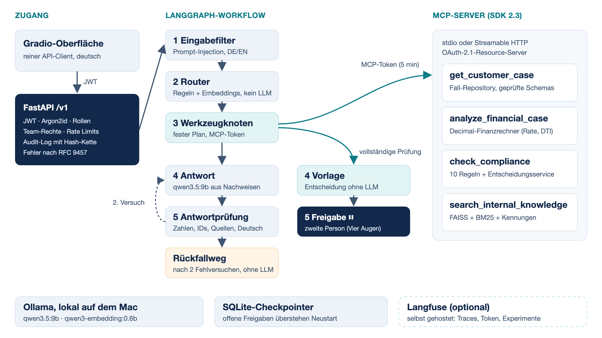
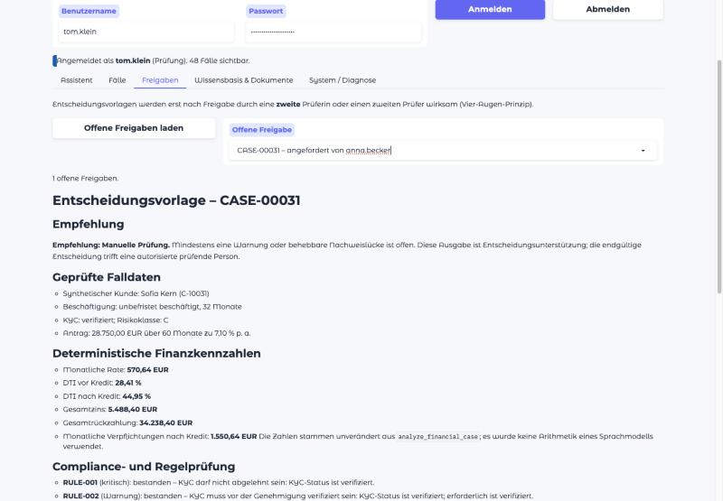
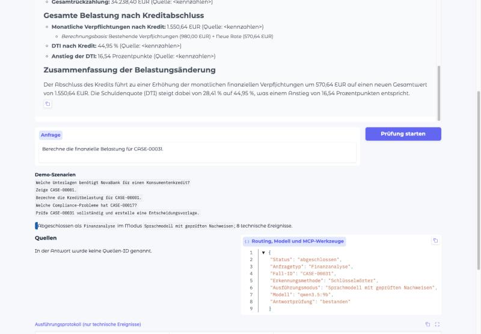

# Secure Enterprise AI Assistant

## Projektdokumentation

**Stand:** v2.1.0, November 2026\
**Fiktiver Kontext:** NovaBank Financial Services AG\
**Laufzeit:** lokal auf einem MacBook Pro M4 Pro (24 GB) mit Ollama

> **Hinweis zu den Daten:** Die NovaBank Financial Services AG gibt es nicht. Alle Kunden,
> Kreditfälle, Richtlinien, Regeln, Beträge und Testfragen dieses Projekts sind synthetisch. Die
> Software ist eine technische Demonstration, keine Bankanwendung und keine Finanz- oder
> Rechtsberatung.

Die erste Fassung dieser Dokumentation (Abschlussprojekt, v1.0.2 mit CrewAI) liegt unverändert
im Git-Tag `v1.0.2`. Dieses Dokument beschreibt den aktuellen Stand.

## 1. Worum es geht

Der Secure Enterprise AI Assistant unterstützt die Kreditsachbearbeitung einer fiktiven Bank.
Mitarbeitende stellen Fragen auf Deutsch, zum Beispiel:

- „Welche Unterlagen benötigt NovaBank für einen Konsumentenkredit?“
- „Berechne die finanzielle Belastung für CASE-00031.“
- „Prüfe CASE-00031 vollständig und erstelle eine Entscheidungsvorlage.“

Der Assistent sucht in internen Richtlinien, lädt Fallakten, rechnet Kennzahlen, prüft Regeln
und formuliert eine Antwort mit Quellen. Eine Entscheidungsvorlage wird erst gültig, wenn eine
zweite Person sie freigibt.

Das Projekt zeigt, wie man ein System mit Sprachmodell so baut, dass Fakten nachprüfbar bleiben.
Die wichtigste Regel lautet: **Fakten kommen aus Code, Sprache kommt aus dem Modell.**

## 2. Ausgangslage und Ziel

Bei einer Kreditprüfung kommen vier Arten von Information zusammen: strukturierte Falldaten,
Rechnungen, feste Regeln und Richtlinientexte. Ein Sprachmodell allein ist dafür ungeeignet. Es
kann sich verrechnen, Regeln übersehen oder Schwellenwerte erfinden, und seine Antworten klingen
dabei überzeugend.

Ziele des Projekts:

1. Zahlen und Regelbefunde entstehen deterministisch in geprüftem Code.
2. Aussagen über Richtlinien sind mit Dokument und Abschnitt belegt.
3. Jede Modellantwort wird automatisch geprüft, bevor sie jemand sieht.
4. Das Modell darf keine Werkzeuge selbst auswählen („Least Agency“).
5. Rechte werden im Code geprüft, nie im Prompt.
6. Entscheidungen trifft ein Mensch, nach dem Vier-Augen-Prinzip.
7. Alles läuft lokal; kein Datensatz verlässt den Rechner.
8. Qualität wird gemessen, nicht behauptet. Zahlen stammen nur aus echten Läufen.

## 3. Von v1 zu v2

Version 1.0.2 war das Abschlussprojekt des Kurses „NLP & Generative AI“. Ein Prüfbericht
([audit-v1.md](audit-v1.md)) hat danach die Schwächen festgehalten: ein Hashing-Embedder statt
echter Embeddings, geschönte Messwerte, ein Eingabefilter, der 1 von 12 Angriffen erkannte,
CrewAI mit einem 24B-Modell über der Hardware-Grenze, keine Anmeldung und keine Rollen.

Version 2 entstand in neun Paketen. Jedes Paket hatte einen eigenen Branch, einen Pull Request,
einen Tag und eine Lernnotiz ([docs/lernnotizen/](lernnotizen/)).

| Paket | Inhalt | Tag |
|------|------------------------------------------------------|--------|
| 0 | Fundament: strenge Typprüfung, strukturiertes Logging, Abhängigkeiten prüfen | v1.0.3 |
| 1 | Deutsch durchgängig: Richtlinien, Regeln, Prompts, Meldungen | v1.1.0 |
| 2 | Echte Embeddings, hybride Suche, hybrider Router | v1.2.0 |
| 3 | FastAPI mit Anmeldung, Rollen, Rate Limits, Audit-Log | v1.3.0 |
| 4 | LangGraph statt CrewAI, Antwortprüfung, Freigabe | v1.4.0 |
| 5 | MCP 2.x über Streamable HTTP mit eigenen Tokens | v1.5.0 |
| 6 | Langfuse: Traces, Kosten, Datensätze, Experimente | v1.6.0 |
| 7 | Testpyramide, Docker Compose, deutsche README | v2.0.0 |
| 8 | Alles deutsch bedienbar, neue Dokumente und Präsentation | v2.1.0 |

## 4. Architektur

Eine Anfrage nimmt diesen Weg:

1. **Gradio-Oberfläche:** Anmeldung und Chat. Die Oberfläche ist nur ein Client der API.
2. **FastAPI:** prüft das JWT, die Rolle, die Rate Limits und schreibt das Audit-Log.
3. **LangGraph-Workflow:** Eingabefilter, Router, Werkzeugknoten, Antwort, Antwortprüfung.
4. **MCP-Server:** vier freigegebene Werkzeuge vor den Fachdiensten. Jedes Werkzeug prüft die
   Rechte der anfragenden Person noch einmal.
5. **Ollama:** das Sprachmodell `qwen3.5:9b` und das Embedding-Modell `qwen3-embedding:0.6b`,
   beide lokal.

Grundsätze der Architektur:

- **Fakten aus Code:** Fallakten, Rechnungen, Regelbefunde und Empfehlungen liefern
  deterministische Dienste hinter MCP.
- **Least Agency:** Der Router legt den Werkzeugplan fest. Ein eingeschleuster Text in einem
  Dokument kann deshalb keinen Werkzeugaufruf auslösen.
- **Mehrfache Rechteprüfung:** in der API, im Graphen (Vorlage, Freigabe) und in jedem
  MCP-Werkzeug.
- **Kein Token Passthrough:** Die API gibt ihr eigenes Token nie weiter. Für jeden Lauf stellt
  sie ein eigenes MCP-Token aus (Audience `novabank-mcp`, fünf Minuten).

## 5. Synthetische Datenbasis

- **48 Kreditfälle** in acht Risikoszenarien, reproduzierbar erzeugt
  (`scripts/generate_synthetic_data.py`)
- **18 Richtlinien** mit Dokument-ID, Version, Gültigkeit, Verantwortlichen und Klassifizierung
  (`intern` oder `vertraulich`), alle auf Deutsch, mit deutschen Dateinamen
- **10 Regeln** als versioniertes JSON, jede mit Quelle (Dokument und Abschnitt)
- **Testsammlungen** für Routing, Suche, Eingabefilter, Finanzen, Compliance und Antwortqualität,
  jeweils mit getrenntem Entwicklungs- und Testteil

Technische Codes in den Daten bleiben stabil (zum Beispiel `rejected` oder `identity_document`).
Die Oberfläche und alle Antworten zeigen dazu deutsche Bezeichnungen.

## 6. Deterministische Fachlogik

**Finanzrechner.** Der Rechner arbeitet mit `Decimal` und rundet kaufmännisch. Er liefert die
Annuitätenrate, Gesamtzins, Gesamtrückzahlung, die Schuldendienstquote (DTI) vor und nach dem
Kredit, die monatlichen Verpflichtungen nach dem Kredit und den Anstieg der DTI in
Prozentpunkten. Die letzten beiden Werte kamen in v2 dazu: Vorher hatte das Modell die Summe
selbst gerechnet, und die Antwortprüfung musste die Antwort verwerfen.

**Regelwerk.** Zehn Regeln prüfen KYC, Pflichtunterlagen, Gültigkeit der Unterlagen, DTI-Schwellen
(Prüfung über 40 %, harte Grenze über 50 %), Risikoklasse, befristete Beschäftigung, Betrag und
Laufzeit. Jede Regel nennt ihre Quelle. Ein Entscheidungsdienst leitet daraus die Empfehlung ab:
Genehmigungskandidat, manuelle Prüfung oder Ablehnung.

**Beispiel CASE-00031** (synthetisch): Rate 570,64 EUR, Gesamtzins 5.488,40 EUR, DTI steigt von
28,41 % auf 44,95 % (plus 16,54 Prozentpunkte), Verpflichtungen nach Kredit 1.550,64 EUR.
`RULE-005` ist nicht bestanden, weil die DTI über der Prüfschwelle von 40 % liegt; die anderen
neun Regeln sind bestanden. Empfehlung: manuelle Prüfung.

## 7. Suche in den Richtlinien (Advanced RAG)

Die Richtlinien werden nach Abschnitten zerlegt (76 Abschnitte). Metadaten wie Dokument-ID,
Titel, Version, Abschnitt und Klassifizierung bleiben an jedem Abschnitt hängen. Drei Signale
werden kombiniert:

- **Vektorsuche** mit FAISS und `qwen3-embedding:0.6b` über Ollama,
- **Wortsuche** mit BM25S und deutschen Stoppwörtern,
- **Kennungen:** Eine genannte Dokument-ID oder Abschnittsnummer steht immer vorn.

**Filter vor dem Ranking.** Nur Abschnitte, die die Person lesen darf, werden überhaupt bewertet.
Auch die BM25-Statistik wird nur über diese Teilmenge berechnet. So kann ein vertrauliches
Dokument die Reihenfolge nicht verschieben.

**Lieber keine Antwort als eine schwache.** Liegt die beste Fundstelle unter einer Schwelle,
antwortet das System „keine Antwort in den Richtlinien“ und ruft das Modell gar nicht erst auf.
Die Schwelle wurde nur auf dem Entwicklungsteil eingestellt.

Messung am 16.11.2026 (Testteil: 20 beantwortbare Fragen, 4 ohne Antwort):

| Embedder | Recall@5 | MRR | „Keine Antwort“ richtig | Falsch abgelehnt |
|------------------------|-------:|-------:|---------:|---------:|
| Hashing (v1) | 0,75 | 0,60 | 1,00 | 0,10 |
| bge-m3 | 1,00 | 0,92 | 1,00 | 0,00 |
| **qwen3-embedding:0.6b** | **1,00** | **0,98** | **1,00** | **0,00** |
| embeddinggemma | 0,95 | 0,90 | 1,00 | 0,05 |

Die Fragen stammen vom Projektautor. Das ist ein Regressionstest, kein unabhängiger Benchmark.

## 8. Routing

Fall-IDs erkennt eine Regel (`CASE-00031`, `Fall 31`). Für Fallfragen wählt ein hybrider Router
die Absicht: Eindeutige Stichwörter entscheiden sofort, sonst vergleicht er die Anfrage per
Embedding mit Beispielsätzen. Ein Sprachmodell wird fürs Routing nicht gebraucht.

| Router | Testteil | Latenz im Mittel |
|----------------------------|----------:|-------------:|
| nur Stichwörter | 22/24 | unter 0,1 ms |
| nur semantisch | 24/24 | 25 ms |
| **hybrid** (Standard) | **24/24** | 8 ms |

## 9. LangGraph-Workflow

| Anfrage | MCP-Werkzeuge | Antwort |
|----------------|------------------------|------------------------------|
| Wissensfrage | Suche | Modell aus Fundstellen, oder „keine Antwort“ ohne Modell |
| Kundenfall | Fallakte | Modell aus Falldaten |
| Finanzanalyse | Fallakte, Finanzrechner | Modell aus Kennzahlen |
| Compliance | Fallakte, Regelwerk, Suche | Modell aus Befunden und Quellen |
| Vollständige Prüfung | alle vier | Vorlage ohne Modell, danach Freigabe |

**Antwortprüfung.** Jede Zahl und jede Dokument-ID in der Antwort muss in den Nachweisen stehen.
Richtlinienaussagen brauchen eine Quelle, englische Überschriften sind verboten. Bei Mängeln
bekommt das Modell einen zweiten Versuch mit der Mängelliste. Scheitert auch der, baut der Code
die Antwort aus den strukturierten Daten („verifizierter Rückfallweg“).

**Freigabe.** Eine Entscheidungsvorlage pausiert mit `interrupt`. Erst eine **andere** prüfende
Person kann sie über `POST /v1/reviews/{thread_id}` freigeben oder ablehnen. Eine abgewiesene
Selbstfreigabe prüft ein eigener Knoten; sie führt zurück in eine neue Pause. Der Zustand liegt
in SQLite, offene Freigaben überstehen einen Neustart. Das Zugriffstoken ist Laufzeit-Kontext
und landet nie im Checkpoint (getestet).

## 10. MCP-Server

Der Server nutzt das offizielle MCP-SDK 2.3. Es gibt genau vier Werkzeuge:
`get_customer_case`, `analyze_financial_case`, `check_compliance` und
`search_internal_knowledge`. Ein SQL-, Shell-, URL- oder Dateisystem-Werkzeug gibt es nicht.

- **stdio (Standard):** ein Unterprozess pro Anfrage. Das MCP-Token kommt über
  `NOVABANK_ACCESS_TOKEN`; der Prozess erhält nur freigegebene Einstellungen.
- **Streamable HTTP:** ein eigener, zustandsloser Server in der Rolle eines
  OAuth-2.1-Resource-Servers. Fehlende, gefälschte, abgelaufene oder falsch adressierte Tokens
  bekommen 401 mit Verweis auf die Protected-Resource-Metadaten (RFC 9728).

Erwartete Fehler (unbekannter oder fremder Fall, fehlende Rechte, ungültige Eingabe) kommen mit
deutscher Meldung zurück. Alle anderen Fehler werden maskiert, damit keine internen Details
nach außen gelangen.

## 11. API, Anmeldung und Rollen

Die FastAPI ist der einzige Zugang für die Oberfläche und für andere Systeme. Passwörter liegen
als Argon2id-Hashes vor, Tokens sind kurzlebige JWTs mit festem Algorithmus.

| Rolle | Fälle | Dokumente | Entscheidungsvorlage |
|----------------|------------------|------------------|----------------|
| `sachbearbeiter` | nur das eigene Team | `intern` | nein |
| `pruefer` | alle | `intern`, `vertraulich` | ja |
| `admin` | alle | `intern`, `vertraulich` | ja |

Ein fremder Fall liefert dasselbe 404 wie ein unbekannter. Weitere Kontrollen: Rate Limits für
Anmeldung, Chat und API, geschlossenes CORS, Sicherheitsheader, Fehlerantworten nach RFC 9457 auf
Deutsch und ein Audit-Log mit SHA-256-Hash-Kette, das keine Passwörter und keine Fragetexte
enthält.

## 12. Oberfläche und Bedienung auf Deutsch

Die Gradio-Oberfläche hat die Reiter Assistent, Fälle, Freigaben, Wissensbasis und Diagnose.
Sie ist vollständig deutsch, auch die eingebauten Texte von Gradio.

Seit v2.1 sind auch die Kommandozeilen-Werkzeuge deutsch: Hilfe mit `--hilfe`, deutsche
Fehlermeldungen und deutsche Befehlsnamen. Die englischen Namen aus v2.0 funktionieren als
Aliase weiter.

| Befehl | Zweck |
|------------------------------------------------|------------------------------|
| `novabank-users anlegen / anzeigen / loeschen` | Benutzer verwalten |
| `novabank-index neu-aufbauen / status` | Suchindex aufbauen und prüfen |
| `novabank-audit pruefen` | Hash-Kette des Audit-Logs prüfen |
| `novabank-langfuse pruefen / einrichten / datensaetze / experiment` | Langfuse anbinden |
| `novabank-evaluate` | Offline-Auswertung wie in der CI |
| `novabank-api`, `novabank-ui`, `novabank-mcp` | Dienste starten |

## 13. Beobachtbarkeit mit Langfuse

Langfuse ist optional und läuft selbst gehostet per Docker Compose. Jeder Lauf wird ein Trace:
jeder Graph-Knoten als Span, der Modellaufruf als Generation mit Prompt, Antwort und Token. Das
Benutzerfeld ist ein Pseudonym, der Thread ist die Sitzung. Die Antwortsuite (17 Fragen) und der
Testteil der Suchfragen (24) liegen als Datensätze in Langfuse; ein Experiment schickt alle
Fragen durch den echten Ablauf und bewertet sie.

Live-Prüfung am 16.11.2026: 17 Experiment-Einträge, Fakten im Mittel zu 0,882 richtig (15/17),
14 Generationen mit 12.124 Eingabe- und 2.192 Ausgabe-Token, kein JWT in einer gespeicherten
Beobachtung.

Ohne Schalter und Schlüssel wird kein Client erzeugt. Die Traces enthalten Prompts und damit
Falldaten mit Namen; der Zugang zu Langfuse muss so streng sein wie der zu den Fallakten.

## 14. Qualität und Evaluation

**Offline-Evaluation in der CI.** `reports/evaluation/latest.json` entsteht aus der versionierten
Testsammlung. Die CI rechnet den Bericht neu und vergleicht ihn mit der eingecheckten Fassung,
einschließlich der Hashes von Testsammlung, Fällen, Regeln und Wissensbasis.

| Kennzahl | Ergebnis | Umfang |
|--------------------------------------------|----------:|----------------:|
| Finanzkennzahlen exakt | 1,00 | 5 Fälle × 5 Kennzahlen |
| Regelbefunde exakt | 1,00 | 5 Fälle |
| Routing, Stichwort-Basislinie, Test | 0,92 | 24 Anfragen |
| Eingabefilter, Angriffe erkannt, Holdout | **0,75** | 20 Angriffe |
| Eingabefilter, Fehlalarme, Holdout | 0,00 | 20 harmlose Fragen |

**Antwortqualität des echten Modells** (Lauf 3, 17 deutsche Fragen, `qwen3.5:9b`):

| Kennzahl | Ergebnis |
|------------------------------------------------|----------:|
| alle erwarteten Fakten | 13/15 |
| Fragen ohne Antwort richtig abgelehnt | 2/2 |
| nur gefundene Dokumente zitiert | 12/12 |
| Endantworten mit offenen Prüfmängeln | 0 |
| Handprüfung: vollständig belegt | 11/14 |
| Wissensfragen mit RAG / gleiches Modell ohne RAG | 8/10 / 1/10 |
| Median pro Frage | 9,2 s |

So liest man das ehrlich: Die Fragen stammen vom Autor, und Lauf 3 kam nach Korrekturen auf
derselben Testsammlung; er ist also optimistisch. Die Handprüfung ist strenger als der
LLM-Richter und deshalb maßgeblich. Ohne Nachweise beantwortet dasselbe Modell nur 1 von 10
Richtlinienfragen richtig, weil die Richtlinien erfunden sind.

**Tests.** 321 automatisierte Tests in vier Schichten (Unit, Integration, End-to-End,
Sicherheit) und 4 Live-Tests mit echtem Modell. Dazu kommen `mypy --strict`, Ruff, eine
Mindestabdeckung von 80 %, `pip-audit` und ein Repository-Audit, das nach Geheimnissen und
unbelegten Behauptungen sucht.

## 15. Auslieferung

`compose.yaml` startet API und Oberfläche aus einem Image, optional den MCP-Server über HTTP.
Ollama läuft nativ auf dem Mac, weil es nur dort die GPU nutzt. Alle Ports sind nur an
`127.0.0.1` gebunden; die Container laufen schreibgeschützt und ohne Linux-Capabilities. Die
Abhängigkeiten sind in einer Lock-Datei festgelegt, die CI prüft sie auf bekannte Schwachstellen.

## 16. Wichtige Entscheidungen

- **LangGraph statt CrewAI:** CrewAI verlangt `mcp<2` und lässt das Modell Werkzeuge wählen.
  LangGraph gibt einen festen, prüfbaren Ablauf mit Pausen für Menschen.
- **Eigener kleiner MCP-Client statt Adapter:** Der Adapter hätte MCP-Werkzeuge zu Werkzeugen
  gemacht, die das Modell selbst wählt. Das widerspricht „Least Agency“.
- **Offizielles MCP-SDK statt FastMCP 4:** Das SDK bringt Streamable HTTP und Token-Prüfung mit;
  FastMCP 4 hätte rund 20 zusätzliche Pakete gebracht.
- **Ein 9B-Modell für alles:** Das frühere 24B-Profil lag über der Hardware-Grenze.
- **Vorlagen ohne Modell:** Eine Entscheidungsvorlage enthält nur Daten aus MCP. Das Modell
  formuliert Antworten, aber keine Entscheidungen.
- **Ablehnen ist der sicherere Fehler:** Lieber „keine Antwort“ als eine schwache.

## 17. Grenzen

- **Keine produktive Bankanwendung.** Daten, Richtlinien und Regeln sind erfunden; es gibt keine
  regulatorische Prüfung.
- **Anmeldung:** ein gemeinsamer HS256-Schlüssel statt eines Identity Providers (OpenID
  Connect, SSO, MFA). Die API ist kein vollständiger OAuth-2.1-Autorisierungsserver.
- **Betrieb:** Benutzer in einer JSON-Datei, Rate Limits nur im Speicher eines Prozesses, kein
  TLS in der Anwendung, das Audit-Log macht Manipulation sichtbar, verhindert sie aber nicht.
- **Qualität:** kleine Testsammlungen vom Autor, keine unabhängige Prüfung, schwacher Richter.
  Die Antwortprüfung erkennt falsche Wörter ohne Zahl oder ID nicht.
- **Eingabefilter:** 15 von 20 Angriffen im Holdout. Er ist eine Schicht, kein Schutz für sich.
- **Tracing:** keine Maskierung personenbezogener Daten außer Tokens, keine Löschfrist.
- **Sprache:** Python-Code, Kommentare, Log-Ereignisnamen und technische Codes bleiben englisch,
  ebenso Texte von Fremdsoftware (Swagger-Seite unter `/docs`, Ausgaben von Langfuse und MCP-SDK).

**Nächste Schritte:** ein Reranker für die eine fälschlich abgelehnte Frage, größere und
unabhängig geprüfte Testsammlungen, ein Identity Provider und Maskierung personenbezogener Daten
im Tracing.

## 18. Fazit

Der Assistent verbindet ein lokales Sprachmodell mit deterministischer Fachlogik, hybrider Suche,
MCP und einem LangGraph-Workflow mit menschlicher Freigabe. Das Modell formuliert, der Code
liefert die Fakten, eine automatische Prüfung kontrolliert jede Antwort, und eine zweite Person
entscheidet. Die Messwerte sind ehrlich eingeordnet, die Grenzen offen benannt.
